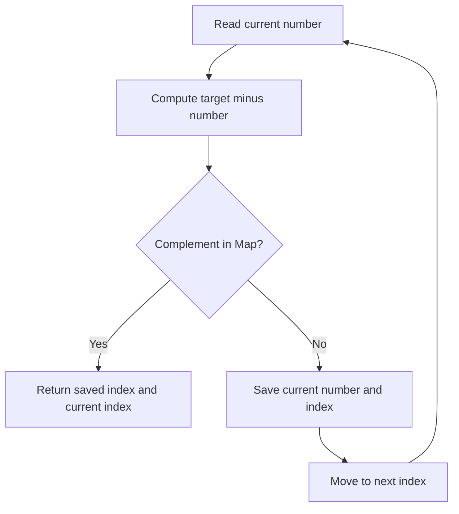

# 1. Two Sum — Brute Force vs Hash Map

**LeetCode:** https://leetcode.com/problems/two-sum/  
**Difficulty:** Easy  
**Status:** ✅ Solved independently  
**Pattern:** Hash Map (optimized); nested loops (brute force). **Not** a two-pointer or sliding-window solution.

## Problem
Given an integer array `nums` and a target, return indices of two **different** elements whose sum is the target. Exactly one valid answer is guaranteed in LeetCode.

## Approach 1 — My original brute-force solution

```javascript
var twoSum = function(nums, target) {
    for(let i = 0; i < nums.length; i++ ){
        let remain =  target - nums[i];
        for(let j= i+1; j<nums.length; j++){
                if(remain == nums[j]){
                    return [i , j];
                }
            }
    }
};
```

### How it works
1. Fix a first number at index `i`.
2. Calculate `remain = target - nums[i]`.
3. Search subsequent indices `j = i + 1 ... n - 1` for the remaining value.
4. Return the pair of indices when found.

**Why `j = i + 1`?** It prevents using the same index twice and avoids checking a pair in both directions.

**Dry run:** `nums = [2,7,11,15]`, `target = 9`

| i | nums[i] | remain | j | nums[j] | Result |
|---|---:|---:|---:|---:|---|
| 0 | 2 | 7 | 1 | 7 | Return `[0,1]` |

**Time:** O(n²) worst case because of nested loops. **Extra space:** O(1).

## Approach 2 — My optimized Hash Map solution (final)

```javascript
var twoSum = function(nums, target) {
    let map = new Map();

    for(let i = 0; i < nums.length; i++ ){
       let remain = target - nums[i];
       if(map.has(remain)){
        return [map.get(remain) , i];
       }
       map.set(nums[i] , i)
    }
};
```

### How it works
- The Map stores **number → index** for elements already visited.
- At each index, calculate `remain = target - nums[i]`.
- If `remain` is in the Map, return its saved index and the current index.
- Otherwise, store the current number and index for future iterations.

**Important order:** `map.has(remain)` must run **before** `map.set(nums[i], i)`. Otherwise, with `nums = [3,2,4]` and `target = 6`, inserting `3` first would wrongly return `[0,0]` using the same element twice.

### Dry run: `nums = [3,2,4]`, `target = 6`

| i | Current | remain | Map before check | Action |
|---|---:|---:|---|---|
| 0 | 3 | 3 | `{}` | Not found; save `3 → 0` |
| 1 | 2 | 4 | `{3 → 0}` | Not found; save `2 → 1` |
| 2 | 4 | 2 | `{3 → 0, 2 → 1}` | Found; return `[1,2]` |



**Time:** O(n) average, assuming average O(1) Map lookup and insertion. **Extra space:** O(n) worst case.

## Comparison

| Feature | Brute force | Hash Map — optimized |
|---|---|---|
| Data structure | Nested loops | JavaScript `Map` |
| Time complexity | O(n²) | **O(n) average** |
| Extra space | **O(1)** | O(n) |
| Checks | Repeated search | Lookup previously seen complement |
| Input order | Unchanged | Unchanged |
| Returns original indices | Yes | Yes |
| Interview preference | Good starting point | **Preferred when time matters** |

## Edge cases

| nums | target | Valid output | Why |
|---|---:|---|---|
| `[2,7,11,15]` | 9 | `[0,1]` | Basic |
| `[3,2,4]` | 6 | `[1,2]` | Complement seen earlier |
| `[3,3]` | 6 | `[0,1]` | Duplicate values, distinct indices |
| `[-3,4,3,90]` | 0 | `[0,2]` | Negative number |
| `[0,4,3,0]` | 0 | `[0,3]` | Two zeros |

## Interview notes
- Why not sort first? Sorting may lose original indices unless original positions are tracked.
- Why Map instead of Set? We must return **indices**, not just detect a pair.
- Why check before insert? Prevents matching a number with itself at the same index.
- JavaScript `Map` preserves number keys and stores their indices.
- Both original implementations return `undefined` if no pair exists; LeetCode guarantees one solution.

[← Practice sheet](README.md) · [Dashboard](../DASHBOARD.md)
