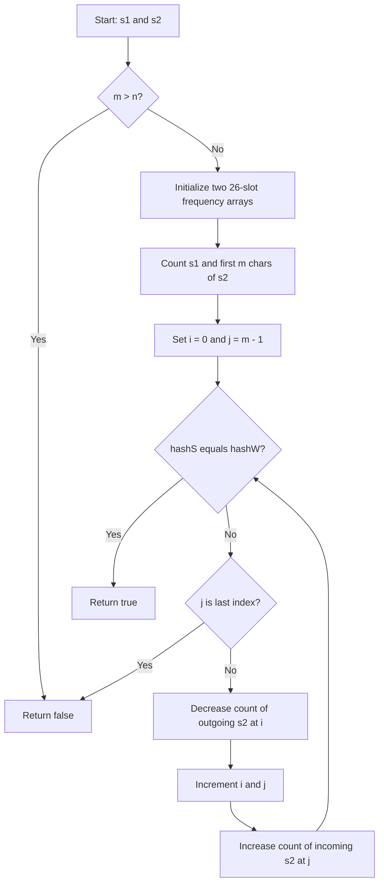

# 567. Permutation in String — Two Sliding Window Approaches

[LeetCode 567](https://leetcode.com/problems/permutation-in-string/) · Medium · Fixed-size Sliding Window · Sorting / Frequency Array

## Problem
Return `true` if any **contiguous substring** of `s2` is a permutation (anagram) of `s1`. A permutation has the same character counts in any order. The window length must be `s1.length`.

Example: `s1 = "ab", s2 = "eidbaooo"` → `true`, because the window `"ba"` contains one `a` and one `b`.

> **Important:** Never sort the entire `s2`: it destroys the original adjacency. For example `s1="ab", s2="acb"` must be false, even though sorting the whole `s2` produces `"abc"`.

## Approach 1 — Sorting + Fixed-Size Sliding Window (using `slice()`)

### JavaScript
```javascript
var checkInclusion = function(s1, s2) {
    let m = s1.length;
    let n = s2.length;
    if (m > n) return false;

    let sortedS1 = s1.split("").sort().join("");
    let i = 0;
    let j = m - 1;

    while (j < n) {
        let window = s2.slice(i, j + 1);
        let sortedWindow = window.split("").sort().join("");

        if (sortedS1 === sortedWindow) return true;

        i++;
        j++;
    }
    return false;
};
```

### Algorithm
1. If `s1` is longer than `s2`, return false.
2. Sort `s1` **once**.
3. Keep a fixed-size window `[i, j]` of length `m` over the **original** `s2`.
4. Extract `s2.slice(i, j + 1)` (end is **exclusive**), sort this window and compare with sorted `s1`.
5. Return true on a match; otherwise move both pointers by one. Return false if no window matches.

### Pointer diagram
```text
s1 = "ab"      sortedS1 = "ab"
s2 = "e i d b a o o o"
      ^ ^
      i j        "ei" -> "ei" != "ab"
        ^ ^
        i j      "id" -> "di" != "ab"
          ^ ^
          i j    "db" -> "bd" != "ab"
            ^ ^
            i j  "ba" -> "ab" == "ab" -> true
```

**Complexity:** Sort `s1` in O(m log m); there are `n-m+1` windows, each copied and sorted in O(m log m). Total **O(m log m + (n-m+1)·m log m)**, often written **O(n·m log m)**; auxiliary space **O(m)** for the extracted/sorted window (ignoring engine-specific sorting overhead).

## Approach 2 — Optimized: Your Frequency Hash Arrays + Fixed-Size Sliding Window

**Your original solution is preserved below**, with only a guard to avoid adding a character after the final window.

### JavaScript — original structure, minimal boundary fix
```javascript
/**
 * @param {string} s1
 * @param {string} s2
 * @return {boolean}
 */
var checkInclusion = function(s1, s2) {
  if(s1.length > s2.length) return false;
  let m = s1.length;
  let n = s2.length;
  let window_length = m;

  //generate hash for input array s1 and sliding window
  let hashS = Array(26).fill(0);
  let hashW = Array(26).fill(0);

  for(let i = 0; i < window_length; i++){
    ++hashS[s1.charCodeAt(i) - 97];
    ++hashW[s2.charCodeAt(i) - 97];
  }

  //now compare hash map
  let i = 0;
  let j = window_length - 1;
  while(j < n){
    if(isHashSame(hashS, hashW)){
        return true;
    }else{
        // Boundary fix: the last window was already checked.
        if (j === n - 1) break;

        --hashW[s2.charCodeAt(i) - 97];
        ++i;
        ++j;
        ++hashW[s2.charCodeAt(j) - 97];
    }
  }
  return false;
};

var isHashSame = function(hashS, hashW){
    for(let k = 0; k < 26; k++){
        if(hashS[k] !== hashW[k]) return false;
    }
    return true;
};
```

### Why is this called hashing?
Here `hashS` and `hashW` are **frequency arrays**, not JavaScript `Map` objects:
- `hashS` counts each lowercase character in `s1` (fixed target).
- `hashW` counts each lowercase character in the **current window** of `s2`.
- Array index 0 is `a`, index 1 is `b`, ..., index 25 is `z`.
- If every count matches, the window is a permutation regardless of character order.

### How `charCodeAt()` works (ASCII / Unicode code units)

`str.charCodeAt(i)` returns the UTF-16 code unit of the character at index `i`. For lowercase English letters, these values coincide with ASCII:

| Character | `charCodeAt()` | Subtract 97 | Frequency index |
|---|---:|---:|---:|
| `a` | 97 | 97 − 97 | 0 |
| `b` | 98 | 98 − 97 | 1 |
| `c` | 99 | 99 − 97 | 2 |
| `e` | 101 | 101 − 97 | 4 |
| `z` | 122 | 122 − 97 | 25 |

```javascript
"a".charCodeAt(0); // 97
"b".charCodeAt(0); // 98
"z".charCodeAt(0); // 122

// If s1[i] is 'b':
++hashS[s1.charCodeAt(i) - 97];
// equivalent to ++hashS[1], counting one more 'b'.
```

**Why 26?** The problem restricts both strings to lowercase English letters. This fixed alphabet makes memory O(1). The same indexing would not work unchanged for uppercase letters, emojis, or arbitrary Unicode.

### Optimized algorithm
1. Reject `m > n`.
2. Allocate two arrays of length 26, initialized to zero.
3. For the first `m` positions, count characters in `s1` and the initial `s2` window.
4. Set `i=0`, `j=m-1`. While `j<n`, compare `hashS` and `hashW` via `isHashSame()`.
5. If equal, return true.
6. If the current window is the **last window**, stop. Otherwise decrement the outgoing `s2[i]` frequency, increment `i` and `j`, and increment the incoming `s2[j]` frequency.
7. If no window matched, return false.

### Flowchart (Mermaid)


### Sliding window pointer diagram
```text
s1 = "ab"
hashS: a=1, b=1, all other letters=0

s2 indices: 0 1 2 3 4 5 6 7
s2 chars:   e i d b a o o o

Window 1:   [e i] d b a o o o   hashW: e=1, i=1   mismatch
Window 2:    e [i d] b a o o o  hashW: i=1, d=1   mismatch
Window 3:    e i [d b] a o o o  hashW: d=1, b=1   mismatch
Window 4:    e i d [b a] o o o  hashW: b=1, a=1   MATCH!

Sliding from "db" to "ba":
  outgoing = 'd' -> --hashW['d'.charCodeAt(0) - 97]
  i++, j++        -> move both pointers right
  incoming = 'a' -> ++hashW['a'.charCodeAt(0) - 97]
  hashW now matches hashS -> return true
```

### Frequency comparison for the matching window

| Character | `hashS` for `"ab"` | `hashW` for `"ba"` |
|---|---:|---:|
| a | 1 | 1 |
| b | 1 | 1 |
| other 24 letters | 0 | 0 |

### Why the boundary fix matters
In the original submitted code, after checking the last window with `j=n-1`, the `else` branch increments `j` to `n` and executes `s2.charCodeAt(n)`, which returns `NaN`. `hashW[NaN]` is not a valid frequency slot. The added `if (j === n - 1) break;` avoids reading beyond the string. This is a correctness/robustness fix; the overall sliding-window idea was correct.

### Complexity
- Initial counts: O(m).
- Windows checked: at most `n-m+1`.
- `isHashSame` scans exactly **26** entries each time, which is constant.
- **Time: O(m+n)**; **space: O(1)** (two fixed 26-element arrays).

## Comparison

| Approach | Time | Auxiliary space | Key tradeoff |
|---|---|---|---|
| 1. Sort each window with `slice()` | O(n·m log m) | O(m) | Simple to understand; repeatedly sorts |
| **2. Your frequency arrays (optimized)** | **O(m+n)** | **O(1)** | Reuses counts; constant-size comparison |

## Edge cases
- `s1="ab", s2="eidbaooo"` → true (window `ba`).
- `s1="ab", s2="eidboaoo"` → false.
- `s1="a", s2="a"` → true.
- `s1="abc", s2="ab"` → false (too short).
- `s1="aab", s2="xxaba"` → true (repeated `a` counted correctly).
- `s1="ab", s2="acb"` → false (same letters spread apart, not contiguous).

## Mistake tracker / takeaways
- **Off-by-one:** `slice(i, j + 1)` because the end is exclusive.
- **Out-of-bounds:** do not add `s2[j]` after `j` becomes `n`.
- **Don't sort all of `s2`:** permutation must occur in an original contiguous window.
- **Frequency not position:** equal frequency arrays imply a permutation.
- **Fixed window invariant:** always remove one outgoing and add one incoming character.
- **JavaScript detail:** `charCodeAt(index)` returns a numeric code unit; subtracting 97 maps `a..z` to indices `0..25`.

[← Two Pointers & Sliding Window sheet](README.md) · [Dashboard](../DASHBOARD.md)
