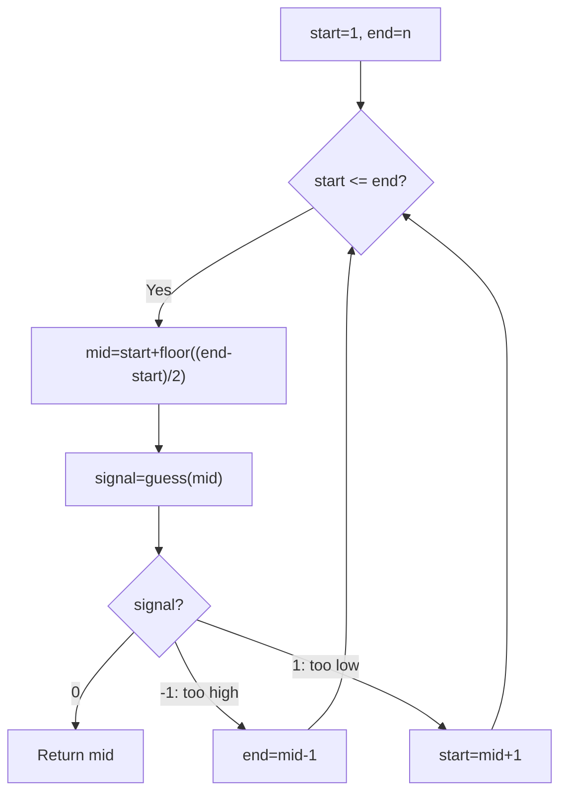

# 374. Guess Number Higher or Lower — Binary Search

[LeetCode 374](https://leetcode.com/problems/guess-number-higher-or-lower/) · Easy · **Solved** · Pattern: Binary Search

## Problem

A hidden number is picked between `1` and `n`. The provided `guess(num)` API returns:
- `-1`: your guess is **too high**.
- `1`: your guess is **too low**.
- `0`: your guess is correct.

Find the hidden number efficiently.

## My original solution (preserved)

```javascript
/** 
 * Forward declaration of guess API.
 * @param {number} num   your guess
 * @return       -1 if num is higher than the picked number
 *               1 if num is lower than the picked number
 *               otherwise return 0
 * var guess = function(num) {}
 */

/**
 * @param {number} n
 * @return {number}
 */
var guessNumber = function(n) {
    let start = 1;
    let end = n;
    while(start <= end){
        //suppose i guess the num is mid
        let mid = start + Math.floor((end - start) / 2);

        //and now pass my guess to check whether it is equla , smaller or larger than picked number
        let signal = guess(mid);
        if(signal == 0) return mid;
        else if(signal == -1){
            end = mid-1;
        }else{
            start = mid + 1;
        }
    }
};
```

## Explanation (simple Hinglish)

1. Search space is `[1, n]`.
2. Calculate `mid` to guess the middle candidate.
3. Call `guess(mid)` **once** per iteration and save its result in `signal`.
4. If `signal == 0`, answer found: return `mid`.
5. If `signal == -1`, the guess is too large, so search the **left** half with `end = mid - 1`.
6. Otherwise `signal == 1`: guess too small, so search the **right** half with `start = mid + 1`.
7. Repeat until found. The problem guarantees the hidden number exists within the range.

## Graphic — n = 10, picked number = 6

```text
Start:   [1 2 3 4 5 6 7 8 9 10]
                 ↑
               mid=5  → guess(5)=1 (too low)
                        keep [6 7 8 9 10]

Step 2:  [6 7 8 9 10]
              ↑
            mid=8  → guess(8)=-1 (too high)
                     keep [6 7]

Step 3:  [6 7]
           ↑
         mid=6 → guess(6)=0 → return 6
```

### Flowchart



## Optional readability variant (same optimal algorithm)

```javascript
var guessNumber = function(n) {
    let start = 1;
    let end = n;

    while (start <= end) {
        const mid = start + Math.floor((end - start) / 2);
        const result = guess(mid);

        if (result === 0) return mid;
        if (result < 0) end = mid - 1;
        else start = mid + 1;
    }
};
```

This is **not faster** than your original solution. It only uses strict equality and slightly shorter branches.

## Complexity and optimality

- **Time:** `O(log n)`, since each wrong guess halves the candidate range.
- **Extra space:** `O(1)`.
- **API calls:** `O(log n)` in the worst case.
- **Why optimal:** With higher/lower feedback, the worst-case number of comparisons must grow logarithmically with the number of candidates.

## Quick checks

| n | picked number | answer |
|---:|---:|---:|
| 1 | 1 | 1 |
| 2 | 1 | 1 |
| 10 | 6 | 6 |
| 100 | 100 | 100 |

**Interview takeaway:** Trust the API contract: `-1` means **your guess** is too high, not that the hidden number is too high. Always update the correct half.

[← Searching & Sorting section](./README.md)
