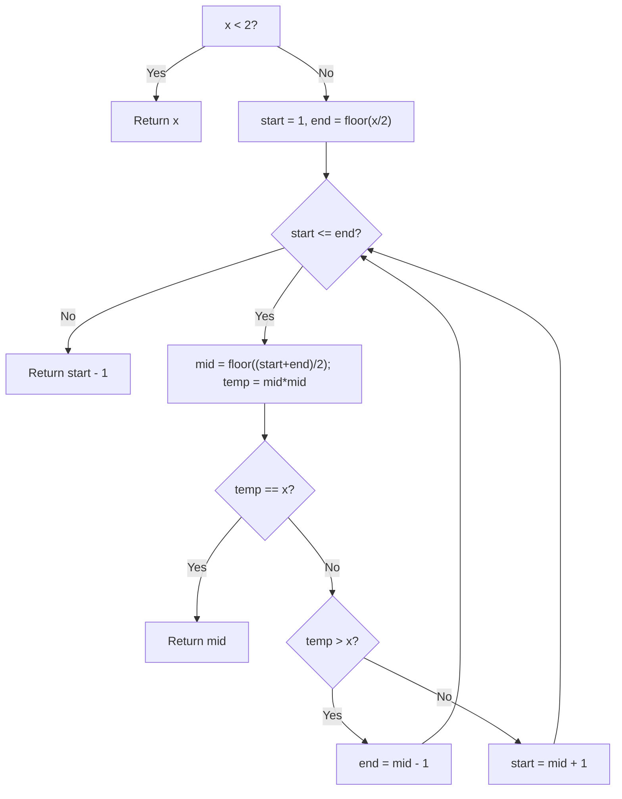

# 69. Sqrt(x) — Binary Search on Answer

[LeetCode 69](https://leetcode.com/problems/sqrtx/) · Easy · **Solved**

## Problem

Given a non-negative integer `x`, return the integer part of its square root (round down). Do not use built-in square-root or exponent operators.

Example: `x = 8` → `2`, because `2² = 4 ≤ 8` but `3² = 9 > 8`.

## My final solution (preserved)

```javascript
/**
 * @param {number} x
 * @return {number}
 */

var mySqrt = function(x) {
    let start = 1;
    let end = Math.floor(x/2);
    if(x < 2) return x;
    while(start <= end){
        let mid = Math.floor((start + end) / 2);
        let temp = mid * mid;
        if(temp == x) return mid;
        else if(temp > x){
            end = mid-1;
        }else{
            start  = mid+1;
        }
    }
    return start-1;
};
```

## Explanation — simple Hinglish

- `x < 2` means `0` or `1`, so return directly.
- For `x >= 2`, try integer answers from `1` to `floor(x / 2)`.
- Choose middle number `mid`, calculate `temp = mid * mid`.
- If `temp === x`, exact root found.
- If `temp > x`, mid is too large: `end = mid - 1`.
- Otherwise mid is valid but a bigger root might exist: `start = mid + 1`.
- When loop stops without exact match, `end = start - 1` is the **largest valid integer** whose square is at most `x`.

## Graphic: Binary Search for x = 8

```text
Candidate:       1     2     3     4
Candidate²:      1     4     9    16
                       ↑
                   answer = 2

Step 1: start=1, end=4, mid=2 → 4 < 8 → start=3
Step 2: start=3, end=4, mid=3 → 9 > 8 → end=2
Stop:   start=3, end=2 → return start - 1 = 2
```



## Why `start - 1` works

Binary Search keeps narrowing the candidates. For non-perfect squares, the loop finishes when `start > end`. At that point `end = start - 1`, and `end` is the largest candidate whose square is not greater than `x`. So either `return end` or `return start - 1` works.

## Edge cases

| x | Expected |
|---:|---:|
| 0 | 0 |
| 1 | 1 |
| 2 | 1 |
| 4 | 2 |
| 8 | 2 |
| 16 | 4 |
| 25 | 5 |
| 2147395599 | 46339 |

## Complexity

- **Time:** `O(log x)` — search range halves each iteration.
- **Space:** `O(1)` — a few numeric variables.

**Pattern:** Binary Search on Answer. Instead of searching for an existing array element, search for the **maximum integer `k` satisfying `k*k <= x`**.

[← Searching & Sorting section](./README.md)
