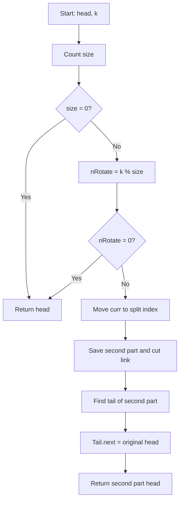

# 61. Rotate List — LeetCode 61

**Difficulty:** Medium  
**Problem:** https://leetcode.com/problems/rotate-list/  
**Practice sheet:** [Linked Lists](../linked-lists.md)

## Problem

Rotate a singly linked list to the **right** by `k` positions.

```text
Input:  head = [1, 2, 3, 4, 5], k = 2
Output:        [4, 5, 1, 2, 3]
```

## Before opening hints

Try answering these on paper:
- What does rotating right once do?
- If `k` is larger than the list length, do you really need `k` rotations?
- Where should the original list be split?
- How will the last node of the moved section point back to the original head?

<details>
<summary>Hints — reveal only if stuck</summary>

1. First count the number of nodes, `size`.
2. The effective rotation is `k % size` (only when `size > 0`).
3. For a nonzero effective rotation, keep the first `size - nRotate` nodes together and move the rest to the front.
4. The **zero-based index** of the split node is `size - nRotate - 1`.
5. Save the head of the second part **before** setting the split node's `next` to `null`.
6. Attach the tail of the second part to the original head.

</details>

<details>
<summary>Graphics — pointer dry run</summary>

### Example: 1 → 2 → 3 → 4 → 5, k = 2

```text
STEP 1 — Count
head
 ↓
[1] → [2] → [3] → [4] → [5] → null

size = 5
nRotate = 2 % 5 = 2
split index = 5 - 2 - 1 = 2
```

```text
STEP 2 — Find the split node
[1] → [2] → [3] → [4] → [5] → null
             ↑
            curr
```

```text
STEP 3 — Save second part, then cut
                  secondPart
                      ↓
[1] → [2] → [3]    [4] → [5] → null
             ↑
            curr

curr.next = null
```

```text
STEP 4 — Walk to the tail of second part

[4] → [5] → null
       ↑
      part
```

```text
STEP 5 — Attach original head

secondPart
    ↓
   [4] → [5] ──┐
               ↓
              [1] → [2] → [3] → null

Result: 4 → 5 → 1 → 2 → 3 → null
```

### Flowchart



**Pointer safety:** Save `curr.next` before doing `curr.next = null`, or you lose the entry point to the second part.

</details>

<details>
<summary>My original JavaScript solution (as written)</summary>

```javascript
var rotateRight = function(head, k) {

  let size = 0;
  let curr = head;
  while(curr){
    size++;
    curr = curr.next;
  }

  if(size == 0) return head;
  let nRotate = k % size;

  curr = head;
  for(let i = 0 ; i < size - nRotate - 1 ; i++){
    curr = curr.next;
  }
  let secondPart = new ListNode();
  let part = secondPart;
  part.next = curr.next;
  curr.next = null;

  //now move the part to the last
  while(part.next){
    part = part.next;
  };

  part.next = head;

  return secondPart.next;
};
```

**Why this works:** The dummy `secondPart` initially points to the moved suffix. Walking `part` to the end of that suffix lets us attach the original head. Returning `secondPart.next` skips the dummy.

**Special case:** When `nRotate === 0`, `curr` stops at the original tail. The dummy's `next` starts as `null`; then `part.next = head` makes it point to the original list. Thus the original solution still returns the correct list, although it does extra work.

**Time:** O(n). **Extra space:** O(1) (one dummy node and pointers).

</details>

<details>
<summary>Optional simplified solution — after reviewing your own</summary>

```javascript
var rotateRight = function(head, k) {
    if (!head || !head.next) return head;

    let size = 0;
    let curr = head;
    while (curr) {
        size++;
        curr = curr.next;
    }

    let nRotate = k % size;
    if (nRotate === 0) return head;

    curr = head;
    for (let i = 0; i < size - nRotate - 1; i++) {
        curr = curr.next;
    }

    let secondPart = curr.next;
    curr.next = null;

    let tail = secondPart;
    while (tail.next) {
        tail = tail.next;
    }

    tail.next = head;
    return secondPart;
};
```

This removes the extra dummy node and returns early when no rotation is needed. It has the same O(n) time and O(1) extra space.

</details>

## Corner cases to test

- `head = [], k = 3` → `[]`
- `head = [1], k = 100` → `[1]`
- `head = [1, 2, 3], k = 0` → `[1, 2, 3]`
- `head = [1, 2, 3], k = 3` → `[1, 2, 3]`
- `head = [1, 2, 3], k = 4` → `[3, 1, 2]`
- `head = [1, 2, 3, 4, 5], k = 12` → `[4, 5, 1, 2, 3]`

[← Back to practice sheet](../linked-lists.md)
