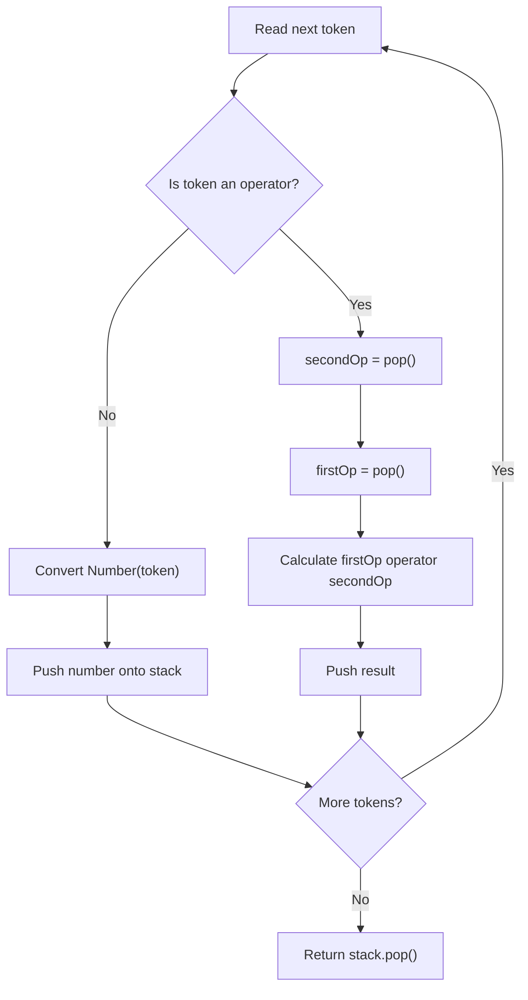
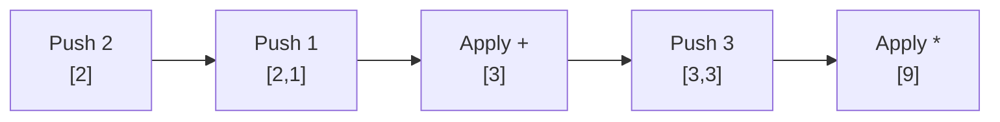

# 150. Evaluate Reverse Polish Notation

**LeetCode:** https://leetcode.com/problems/evaluate-reverse-polish-notation/  
**Difficulty:** Medium  
**Pattern:** Stack / postfix expression evaluation  
**Status:** Solved

## Problem

Evaluate a Reverse Polish Notation (postfix) expression. Each token is an integer or an operator: `+`, `-`, `*`, `/`. Division must truncate toward zero.

Example: `["2","1","+","3","*"]` → `9`, because `(2 + 1) * 3 = 9`.

## My original solution (unchanged)

```javascript
/**
 * @param {string[]} tokens
 * @return {number}
 */
var evalRPN = function(tokens) {
    let operator = new Set(["+" , "-" , "*" , "/"]);
    let stack = [];
    
    for(let i = 0; i < tokens.length ; i++){
        let token = tokens[i];

        if(!operator.has(token)){
            stack.push(Number(token));
        }else{
            let secondOp = stack.pop()
            let firstOp = stack.pop() 
            let result;

            switch (token) {
                case "+":
                    result = firstOp + secondOp;
                    break;

                case "-":
                    result = firstOp - secondOp;
                    break;

                case "*":
                    result = firstOp * secondOp;
                    break;

                case "/":
                    result = Math.trunc(firstOp / secondOp);
                    break;
            }
            stack.push(result);
        }
    }
    return stack.pop();

};
```

## How my approach works

1. Store valid operators in a `Set`; `operator.has(token)` checks whether a token is an operator.
2. For a number token, convert it with `Number(token)` and push it onto the stack.
3. For an operator, pop **secondOp first**, then **firstOp**. Evaluate `firstOp operator secondOp`.
4. Push the result back, so it can be used by the next operator.
5. The remaining stack element is the answer.

**Important:** For subtraction and division, order matters: `firstOp - secondOp`, not `secondOp - firstOp`. `Math.trunc()` rounds toward zero, including for negative results.

## Mermaid graph — evaluation flow



## Step-by-step dry run

Input: `["2", "1", "+", "3", "*"]`

| Token | Action | Stack (bottom → top) |
|---|---|---|
| `"2"` | push 2 | `[2]` |
| `"1"` | push 1 | `[2, 1]` |
| `"+"` | pop 1 and 2; calculate 2 + 1 | `[3]` |
| `"3"` | push 3 | `[3, 3]` |
| `"*"` | pop 3 and 3; calculate 3 × 3 | `[9]` |



## Corner cases

| Input | Result | Why |
|---|---|---|
| `["4","13","5","/","+"]` | 6 | 13 / 5 truncates to 2, then 4 + 2 |
| `["5","3","-"]` | 2 | Operand order matters |
| `["3","5","-"]` | -2 | Negative result |
| `["-7","2","/"]` | -3 | `Math.trunc(-3.5)` is -3 |
| `["42"]` | 42 | Single number |
| `["0","3","*"]` | 0 | Zero operand |

## Complexity

- **Time:** O(n), where `n` is the number of tokens.
- **Space:** O(n) in the worst case for the stack; the operator set has constant size.

## Interview takeaway

RPN does not need parentheses or operator-precedence parsing. A stack makes the last two available operands easy to retrieve in the correct order.

[← Section README](./README.md) · [Practice Sheet](./PRACTICE-SHEET.md)
