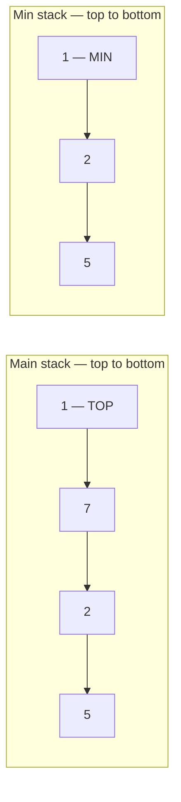
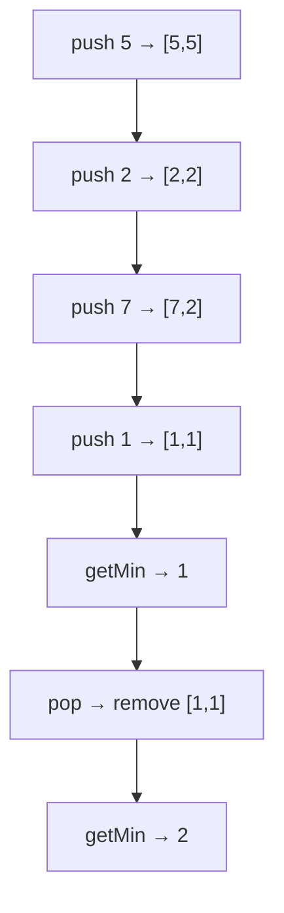

# 155. Min Stack — My Two Approaches

**LeetCode:** https://leetcode.com/problems/min-stack/  
**Difficulty:** Medium  
**Status:** Solved (single-stack pair solution)  
**Pattern:** Stack + tracking minimum

## Problem

Design a stack supporting `push(val)`, `pop()`, `top()`, and `getMin()`, **all in O(1) time**.

## Approach 1 — My first two-stack attempt (original code)

I used `s` for all values and `minStack` for minimum values. This original attempt has three edge-case bugs, explained below.

```javascript
var MinStack = function() {
    this.s = [];
    this.minStack = [];
};

/** 
 * @param {number} value
 * @return {void}
 */

// push any all value to the s and only update the minStack if incoming value is smaller than existing one
MinStack.prototype.push = function(value) {

    this.s.push(value);
    if(this.minStack[this.minStack.length -1] > value ){
        this.minStack.push(value);
    }
};

/**
 * @return {void}
 */
MinStack.prototype.pop = function() {
    
//you are poping a value and suppose that is the smallest value in minStack so
// so i should also remove the same from the minStack

    let popped = this.s.pop();
    if(popped && popped === this.minStack[this.minStack.length - 1]){
        this.minStack.pop();
    }

};

/**
 * @return {number}
 */
MinStack.prototype.top = function() {
    return this.s[this.s.length-1]
};

/**
 * @return {number}
 */
MinStack.prototype.getMin = function() {
  return this.minStack[this.minStack.length - 1];
};
```

### Bugs in my original attempt

1. **First push:** `undefined > value` is false, so the first minimum is never recorded.
2. **Duplicate minimum:** using `>` instead of `>=` for comparing the previous minimum against the incoming value skips duplicate minima.
3. **Zero:** `if (popped && ...)` skips `0`, because `0` is falsy.

### Corrected two-stack version (for comparison)

```javascript
var MinStack = function() {
    this.s = [];
    this.minStack = [];
};

MinStack.prototype.push = function(value) {
    this.s.push(value);
    if (
        this.minStack.length === 0 ||
        value <= this.minStack[this.minStack.length - 1]
    ) {
        this.minStack.push(value);
    }
};

MinStack.prototype.pop = function() {
    const popped = this.s.pop();
    if (popped === this.minStack[this.minStack.length - 1]) {
        this.minStack.pop();
    }
};

MinStack.prototype.top = function() {
    return this.s[this.s.length - 1];
};

MinStack.prototype.getMin = function() {
    return this.minStack[this.minStack.length - 1];
};
```

### Graphic — two-stack state

After `push(5)`, `push(2)`, `push(7)`, `push(1)`:



After `pop()` removes `1`, minStack also removes `1`; `getMin()` becomes `2`.

---

## Approach 2 — My final single-stack solution (original code)

Each entry stores `[actualValue, minimumSoFar]`. This is my final corrected submission.

```javascript
var MinStack = function() {
    this.s = [];
};

/** 
 * @param {number} value
 * @return {void}
 */

MinStack.prototype.push = function(value) {
    if(this.s.length == 0){
        this.s.push([value , value]);
    }else{
        let prevSmall = this.s[this.s.length -1][1]
        this.s.push([value , Math.min(value , prevSmall)])
    }

};

/**
 * @return {void}
 */
MinStack.prototype.pop = function() {
    
this.s.pop();

};

/**
 * @return {number}
 */
MinStack.prototype.top = function() {
    return this.s[this.s.length -1][0];
};

/**
 * @return {number}
 */

MinStack.prototype.getMin = function() {
  return this.s[this.s.length -1][1];
};

/** 
 * Your MinStack object will be instantiated and called as such:
 * var obj = new MinStack()
 * obj.push(value)
 * obj.pop()
 * var param_3 = obj.top()
 * var param_4 = obj.getMin()
 */
```

### Why the pair approach works

- `[0]` is the actual value returned by `top()`.
- `[1]` is the minimum of all values in the stack **up to and including this entry**.
- `push(value)` stores `[value, Math.min(value, previousMin)]`.
- `pop()` removes the pair, automatically restoring the previous minimum.

### Graphic — single-stack dry run



After the four pushes, the stack is:

```text
TOP      [1, 1]  ← minimum = 1
         [7, 2]
         [2, 2]
BOTTOM   [5, 5]
         [value, minimumSoFar]
```

| Operation | Stack from bottom to top | getMin() |
|---|---|---|
| push(5) | `[5,5]` | 5 |
| push(2) | `[5,5], [2,2]` | 2 |
| push(7) | `[5,5], [2,2], [7,2]` | 2 |
| push(1) | `[5,5], [2,2], [7,2], [1,1]` | 1 |
| pop() | `[5,5], [2,2], [7,2]` | 2 |

## Complexity comparison

| Operation | Two stacks | Single stack of pairs |
|---|---|---|
| push | O(1) | O(1) |
| pop | O(1) | O(1) |
| top | O(1) | O(1) |
| getMin | O(1) | O(1) |
| Extra space | O(n) | O(n) |

Both corrected approaches support duplicate minima, `0`, and negative values.

## Edge cases to test

- Push only one value and call `getMin()`.
- Push duplicate minimum values, pop one, and call `getMin()`.
- Push `0` and negative values.
- Push a larger value after a minimum, then pop it.
- Pop the current minimum and verify the previous minimum returns.

**Note:** LeetCode only calls `top()`, `pop()`, and `getMin()` on a nonempty stack.

[← Section README](./README.md) · [Practice Sheet](./PRACTICE-SHEET.md)
