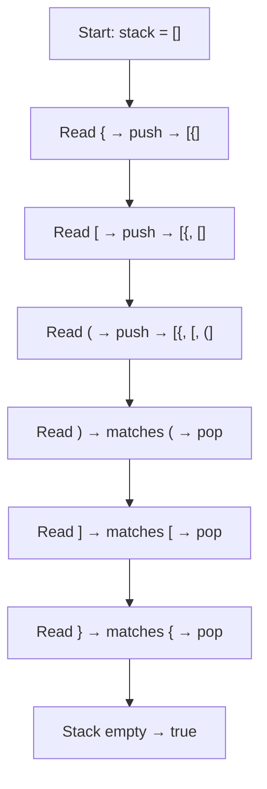

# 20. Valid Parentheses

- **LeetCode:** https://leetcode.com/problems/valid-parentheses/
- **Difficulty:** Easy
- **Status:** Solved
- **Pattern:** Stack + bracket matching map
- **Language:** JavaScript

## Problem

Given a string containing only `(`, `)`, `{`, `}`, `[`, `]`, return `true` when all brackets are correctly matched and nested.

Examples:
- `"()[]{}"` → `true`
- `"{[()]}"` → `true`
- `"(]"` → `false`
- `"([)]"` → `false`
- `"("` → `false`

## My solution 1 — initial working approach (original)

```javascript
/**
 * @param {string} s
 * @return {boolean}
 */
var isValid = function(s) {
   let isMatch= {
    ")" : "(",
    "}" : "{",
    "]" : "["
   };
   let stack = [];

   for(let char of s){
    if(stack.length == 0) {
        stack.push(char)
    
    } else{
        let top = stack[stack.length -1];
        if(top === isMatch[char]){
            stack.pop();
        }else{
            stack.push(char);
        }
    }
   }
   return stack.length == 0

};
```

**Why it works:** When the stack is empty, the character is pushed. Otherwise, matching closing brackets pop the corresponding opening bracket. All other characters are pushed. At the end, the stack must be empty.

## My solution 2 — final simplified version (original)

```javascript
/**
 * @param {string} s
 * @return {boolean}
 */
var isValid = function(s) {
   let isMatch = {
    ")" : "(",
    "}" : "{",
    "]" : "["
   };
   let stack = [];

   for(let char of s){
        let top = stack[stack.length -1];
        if(isMatch[char] && (top === isMatch[char])){
            stack.pop();
        }else{
            stack.push(char)
        }
    }

   return stack.length == 0
};
```

### Why `isMatch[char]` matters

An empty stack has `stack[-1] === undefined`. An opening bracket also has `isMatch["("] === undefined`. So using only `top === isMatch[char]` would wrongly evaluate `undefined === undefined` as true and call `pop()`.

`isMatch[char] && top === isMatch[char]` first confirms that the current character is a **closing bracket**. JavaScript short-circuit evaluation skips the comparison when it is an opening bracket.

## Graphic: stack dry run for `{[()]}`



## How the stack changes

| Character | Action | Stack (bottom → top) |
|---|---|---|
| `{` | push | `{` |
| `[` | push | `{ [` |
| `(` | push | `{ [ (` |
| `)` | pop `(` | `{ [` |
| `]` | pop `[` | `{` |
| `}` | pop `{` | empty |

## Complexity

- **Time:** O(n) — one pass through the string.
- **Space:** O(n) — worst case all opening brackets are stored.

## Corner cases

- `"()"` → true
- `"((("` → false
- `")"` → false
- `"([)]"` → false
- `"{}[]()"` → true

## Learning takeaway

A stack naturally handles the **most recently opened bracket first** (LIFO). Check for closing brackets before comparing with the top. Both of my saved versions are correct for the problem constraints.

[← Stack & Queue Practice Sheet](./PRACTICE-SHEET.md)
