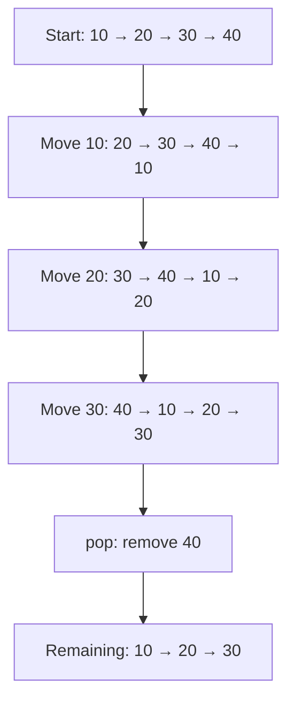
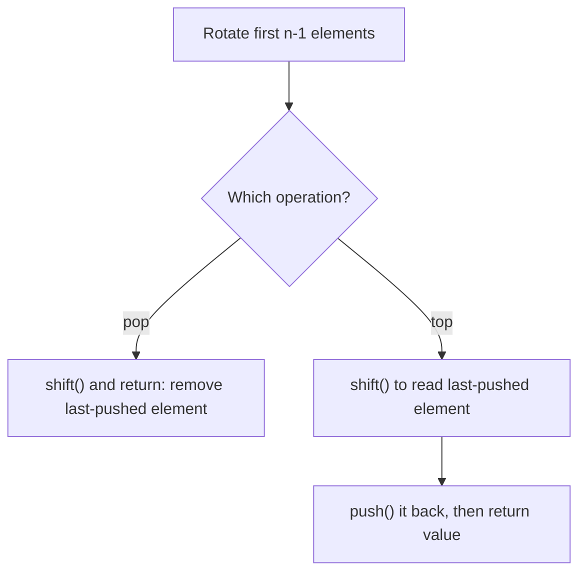

# 225. Implement Stack using Queues

- **Difficulty:** Easy
- **Problem:** https://leetcode.com/problems/implement-stack-using-queues/
- **Status:** Solved
- **Approach:** One queue; rotate during `pop()` and `top()`
- **Language:** JavaScript

## Problem in simple words

Implement a **LIFO stack** using queue operations. The last pushed element must be popped first.

## My original solution

```javascript
var MyStack = function() {
   this.q = [];
};

/** 
 * @param {number} x
 * @return {void}
 */
MyStack.prototype.push = function(x) {
    this.q.push(x);
};

/**
 * @return {number}
 */
MyStack.prototype.pop = function() {
 let n = this.q.length;
 for(let i = 0; i < n-1; i++){
    let ele = this.q.shift();
    this.q.push(ele);
 }
 return this.q.shift();
};

/**
 * @return {number}
 */
MyStack.prototype.top = function() {
    let n = this.q.length;
    for(let i=0; i< n-1; i++){
        let ele = this.q.shift();
        this.q.push(ele);
    }

    let ans = this.q.shift();
    this.q.push(ans);
    return ans;
};

/**
 * @return {boolean}
 */
MyStack.prototype.empty = function() {
    return this.q.length === 0
};

/** 
 * Your MyStack object will be instantiated and called as such:
 * var obj = new MyStack()
 * obj.push(x)
 * var param_2 = obj.pop()
 * var param_3 = obj.top()
 * var param_4 = obj.empty()
 */
```

## Visual: Why rotate?

Suppose the pushes were `10, 20, 30, 40`. The queue starts as `[10, 20, 30, 40]`, but the stack's top is **40**. Move the first `n-1` items to the back:



### pop vs top



**Important detail:** `top()` rotates the queue's internal order, but the next `top()` or `pop()` still returns the correct stack top. The most recently pushed item is at the rear immediately after each operation, and rotating `n-1` elements brings it to the front.

## Dry run

```javascript
const s = new MyStack();
s.push(10);
s.push(20);
s.push(30);
console.log(s.top());   // 30
console.log(s.pop());   // 30
console.log(s.top());   // 20
console.log(s.empty()); // false
console.log(s.pop());   // 20
console.log(s.pop());   // 10
console.log(s.empty()); // true
```

## Complexity

| Operation | Abstract queue (O(1) enqueue/dequeue) | JS Array implementation |
|---|---|---|
| push | O(1) | O(1) amortized |
| pop | O(n) | O(n²) worst case due to shift |
| top | O(n) | O(n²) worst case due to shift |
| empty | O(1) | O(1) |

- Auxiliary space per operation: **O(1)**.
- Total stored elements: **O(n)**.
- The O(n²) bounds for `pop`/`top` are conservative worst-case bounds for array shifting; actual engines may optimize.

## Edge cases

- Empty stack: `empty()` is true. Problem guarantees `pop()`/`top()` are not called on empty stack.
- Single element: no rotation; pop and top both work.
- Duplicate values: order is preserved.
- Repeated `top()`: stack semantics remain correct.
- Push after a `top()` or `pop()`: still works.

## Interview follow-up

Can we rotate inside `push()` instead? Then **push O(n)**, **pop O(1)**, **top O(1)** with abstract O(1) queue operations.

[← Back to Stack & Queue practice sheet](./PRACTICE-SHEET.md)
