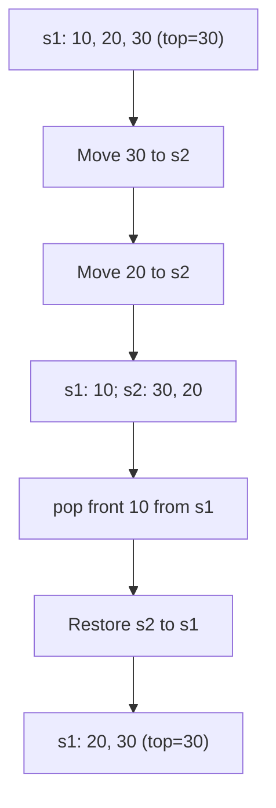

# 232 — Implement Queue using Stacks

[LeetCode problem](https://leetcode.com/problems/implement-queue-using-stacks/) · Easy · Two stacks

## Original solution (as submitted, with bugs)

```js
var MyQueue = function() {
     this.s1 = [];
     this.s2 = [];
};
MyQueue.prototype.push = function(x) {
    this.s1.push(x);
};
MyQueue.prototype.pop = function() {
    for( let i = 0 ; i  < this.s1.length -1; i++){
        let popEle = this.s1.pop();
        this.s2.push(popEle);
    }
    let ans = this.s1.pop();
    while(this.s2.length){
        this.s1.push(this.s2.pop())
    }
    return ans;
};
MyQueue.prototype.peek = function() {
    for( let i = 0 ; i  < this.s1.length -1; i++){
        let popEle = this.s1.pop();
        this.s2.push(popEle);
    }
    let peekEle = this.s1.pop();
    this.s2.push(peekEle);
    while(this.s2.length){
        this.s1.push(this.s2.pop())
        return peekEle;
    }
};
MyQueue.prototype.empty = function() {
    return this.s1.length == 0 && this.s2.length == 0;
};
```

## Bugs to learn from

1. Both `for` loops check `this.s1.length` while `pop()` is shrinking the array. Store the initial length in `n` first.
2. `peek()` returns **inside** the restoration loop. Move the return below the loop so all elements are restored.
3. For `peek()`, restore the front element too: move it into `s2` before transferring everything back.

## Visual dry run



## Corrected version — same approach

```js
var MyQueue = function() {
    this.s1 = [];
    this.s2 = [];
};
MyQueue.prototype.push = function(x) {
    this.s1.push(x);
};
MyQueue.prototype.pop = function() {
    const n = this.s1.length;
    for (let i = 0; i < n - 1; i++) {
        this.s2.push(this.s1.pop());
    }
    const ans = this.s1.pop();
    while (this.s2.length) {
        this.s1.push(this.s2.pop());
    }
    return ans;
};
MyQueue.prototype.peek = function() {
    const n = this.s1.length;
    for (let i = 0; i < n - 1; i++) {
        this.s2.push(this.s1.pop());
    }
    const ans = this.s1.pop();
    this.s2.push(ans);
    while (this.s2.length) {
        this.s1.push(this.s2.pop());
    }
    return ans;
};
MyQueue.prototype.empty = function() {
    return this.s1.length === 0 && this.s2.length === 0;
};
```

## Complexity

| Operation | Time |
|---|---|
| push | O(1) amortized |
| pop | O(n) |
| peek | O(n) |
| empty | O(1) |

O(n) total storage, O(n) temporary auxiliary space during transfers.

## Test

```js
const q = new MyQueue();
q.push(10); q.push(20); q.push(30);
console.log(q.peek());  // 10
console.log(q.pop());   // 10
console.log(q.pop());   // 20
console.log(q.pop());   // 30
console.log(q.empty()); // true
```

**Next challenge:** Keep outgoing elements in s2 instead of moving them back after each call. Each element then moves at most once from s1 to s2, yielding amortized O(1) operations.

[Back to practice sheet](./PRACTICE-SHEET.md)
