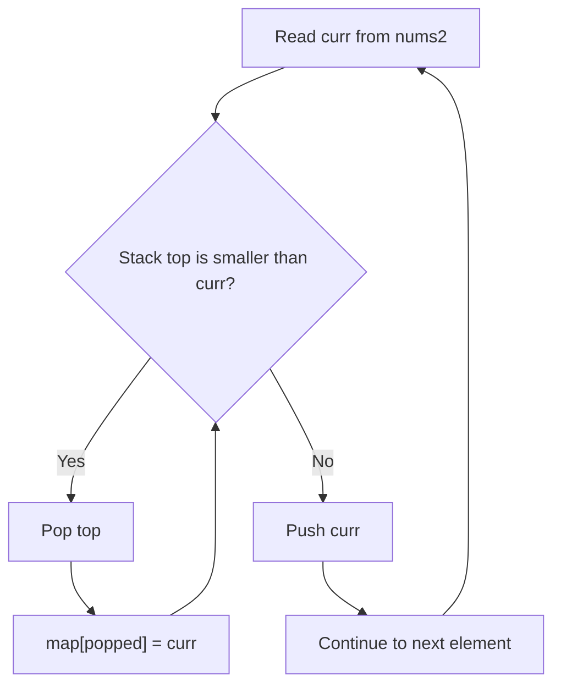
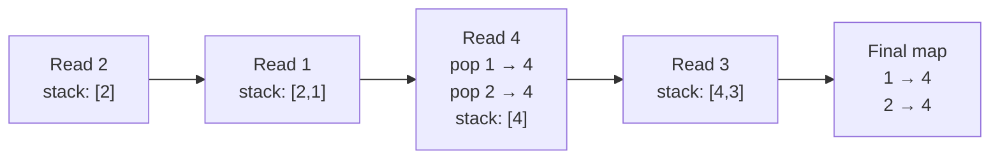
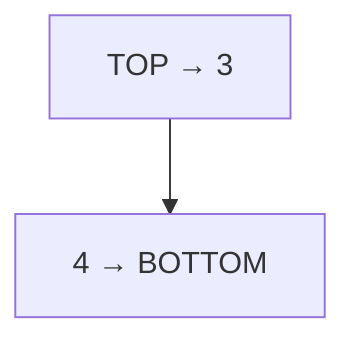

# 496. Next Greater Element I — Monotonic Stack

**LeetCode:** https://leetcode.com/problems/next-greater-element-i/  
**Difficulty:** Easy  
**Pattern:** Monotonic decreasing stack + lookup map  
**Status:** Practiced — one edge-case fix needed

## Problem

Given `nums1` (a subset of `nums2`), find the **first greater number to the right** of each value in `nums2`. If none exists, answer `-1`. Values in `nums2` are distinct.

Example:

```text
nums1 = [4, 1, 2]
nums2 = [1, 3, 4, 2]
answer = [-1, 3, -1]
```

## My original solution — preserved exactly

```javascript
/**
 * @param {number[]} nums1
 * @param {number[]} nums2
 * @return {number[]}
 */
var nextGreaterElement = function(nums1, nums2) {
let map ={};
let stack = [];
//tack the nums2 from back
for(let  i = 0 ; i < nums2.length  ; i++){
    let curr = nums2[i];
    if(stack.length == 0 || curr < stack[stack.length-1] ){
        stack.push(curr);
    }else{
        while(stack.length && curr > stack[stack.length -1] ){
            let top = stack.pop();
            map[top] = curr;
        }
        stack.push(curr);
    }

}
let ans =[];

for(const num of nums1){
    if(map[num]){
        ans.push(map[num])
    }
    else{
        ans.push(-1);
    }
}

return ans;
    
};
```

### What's right about my approach

- Traverse `nums2` from **left to right**, not from back (the original comment is misleading).
- Keep a **monotonically decreasing** stack: bottom → top, values decrease.
- When `curr` is greater than the top, pop smaller values; `curr` is their **first greater value to the right**.
- Record `map[popped] = curr`.
- Unresolved values remain on the stack; their answer is `-1`.

### One important bug — map lookup when answer is 0

The original uses `if (map[num])`. But `0` is falsy.

```javascript
nums1 = [-1];
nums2 = [-1, 0];
// map[-1] = 0, but if (map[-1]) is false
// Original answer: [-1] ❌
// Expected answer: [0] ✅
```

Use `Object.hasOwn(map, num)` or a `Map` with `.has()` instead.

## My solution with minimal fix

The algorithm stays the same; only the lookup is changed:

```javascript
var nextGreaterElement = function(nums1, nums2) {
    let map = {};
    let stack = [];

    for (let i = 0; i < nums2.length; i++) {
        let curr = nums2[i];

        if (stack.length === 0 || curr < stack[stack.length - 1]) {
            stack.push(curr);
        } else {
            while (stack.length && curr > stack[stack.length - 1]) {
                let top = stack.pop();
                map[top] = curr;
            }
            stack.push(curr);
        }
    }

    let ans = [];
    for (const num of nums1) {
        if (Object.hasOwn(map, num)) {
            ans.push(map[num]);
        } else {
            ans.push(-1);
        }
    }
    return ans;
};
```

**Alternative:** `const map = new Map()`; store with `map.set(top, curr)`; read using `map.has(num) ? map.get(num) : -1`.

## Graphic 1 — monotonic stack logic



## Graphic 2 — dry run

`nums2 = [2, 1, 4, 3]`



| Current number | What happens | Stack (bottom → top) | Map |
|---|---|---|---|
| 2 | push 2 | `[2]` | `{}` |
| 1 | 1 < 2 → push 1 | `[2,1]` | `{}` |
| 4 | pop 1 and 2; map both to 4; push 4 | `[4]` | `{1:4, 2:4}` |
| 3 | 3 < 4 → push 3 | `[4,3]` | `{1:4, 2:4}` |

Why is `4` the next greater for `1` and `2`? It is the **first** value encountered to their right that exceeds them.

## Graphic 3 — decreasing stack



At the end, `4` and `3` remain unresolved. No greater value occurs to their right.

## Complexity

- **Time:** O(n + m), where `n = nums2.length`, `m = nums1.length`. Every `nums2` value is pushed once and popped at most once.
- **Space:** O(n) for stack and lookup map.

## Edge cases

- `nums1=[4,1,2], nums2=[1,3,4,2]` → `[-1,3,-1]`
- `nums1=[2,4], nums2=[1,2,3,4]` → `[3,-1]`
- `nums1=[-1], nums2=[-1,0]` → `[0]` (catches falsy-zero bug)
- `nums1=[3], nums2=[3,2,1]` → `[-1]`

## Interview takeaway

A decreasing stack is useful when you need the **next greater element**. A `while` loop is important: one incoming greater value may resolve several earlier smaller values.

[← Section README](./README.md) · [Practice Sheet](./PRACTICE-SHEET.md)
