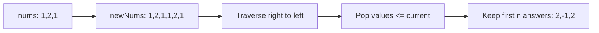
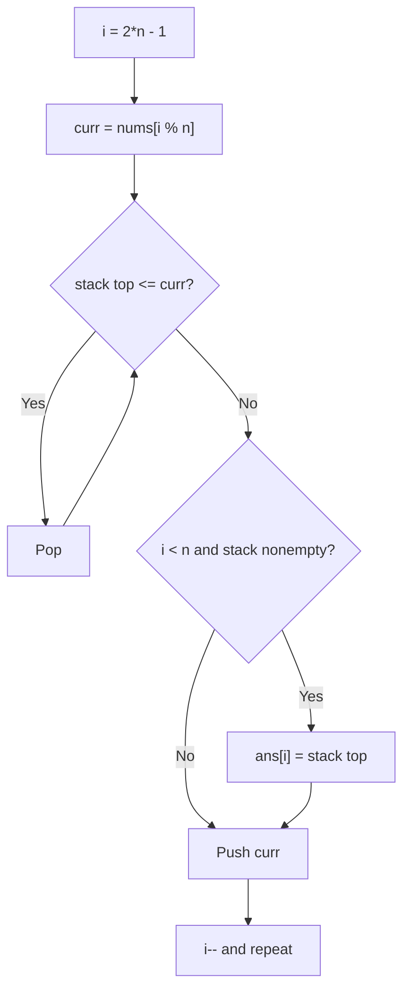
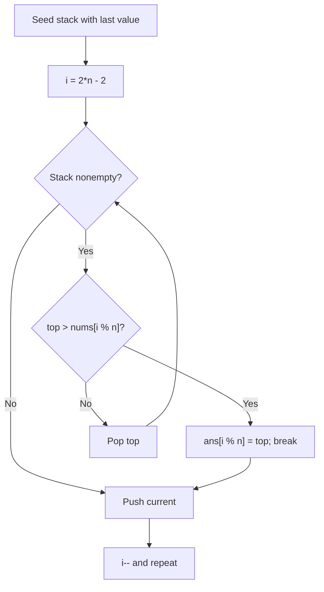

# 503. Next Greater Element II — Three Approaches

[LeetCode 503](https://leetcode.com/problems/next-greater-element-ii/) · Medium · Circular array + monotonic decreasing stack · **Solved**

For each element, find the first **strictly greater** value to its right. The array is circular: after the last element, continue at index 0. If none exists, return -1.

Example: `nums = [1,2,1]` → `[2,-1,2]`.

## Approach 1 — Double the array

### My original code (preserved)

```javascript
/**
 * @param {number[]} nums
 * @return {number[]}
 */
var nextGreaterElements = function(nums) {
let newNums = [...nums, ...nums];
let ans = Array(newNums.length).fill(-1);

let stack =[];
stack.push(newNums[newNums.length-1]);

for(let i = newNums.length-1; i >= 0; i--){
    let curr = newNums[i];
    let top = stack[stack.length-1];
        if(curr < top){
            ans[i] = top;
        }else{
            while(stack.length && curr >= stack[stack.length-1]){
                stack.pop();
            }
            ans[i] = stack[stack.length-1] ?? -1; 
        }

        stack.push(curr);
}

return ans.slice(0,nums.length);
};
```

### Explanation

1. `[...nums, ...nums]` creates a virtual circular trip explicitly. `[1,2,1]` becomes `[1,2,1,1,2,1]`.
2. Traverse right to left. Stack contains possible next-greater values, in decreasing order from bottom to top.
3. If the top is already greater than current, use it. Otherwise pop all values less than or equal to current and take the remaining top, or -1.
4. Push current to help earlier positions. Return the first n answers with `slice(0,n)`.

**Note:** The initial `stack.push(last)` is unnecessary because the loop visits that same last value first; it is harmless for nonempty inputs.

### Graphic



### Dry run

| i | curr | Pop / action | Stack after push | ans[i] |
|---|---:|---|---|---:|
| 5 | 1 | pop initially seeded equal 1 | [1] | -1 |
| 4 | 2 | pop 1 | [2] | -1 |
| 3 | 1 | top 2 greater | [2,1] | 2 |
| 2 | 1 | pop equal 1 | [2,1] | 2 |
| 1 | 2 | pop 1 and 2 | [2] | -1 |
| 0 | 1 | top 2 greater | [2,1] | 2 |

**Time:** O(n). **Space:** O(n), including doubled input, stack and result.

---

## Approach 2 — Modulo + while condition (optimized)

### My original code (preserved)

```javascript
/**
 * @param {number[]} nums
 * @return {number[]}
 */
var nextGreaterElements = function(nums) {
    
 let ans = Array(nums.length).fill(-1);
 let stack =[];

 for(let i = 2*nums.length - 1; i>=0; i--){
    let curr = nums[i % nums.length];

    while(stack.length && stack[stack.length -1] <= curr){
        stack.pop();
    }

    if(i < nums.length && stack.length){
        ans[i] = stack[stack.length -1];
    }
    stack.push(curr);
 }

 return ans;


};
```

### Explanation

1. No duplicate array. Iterate `i` from `2*n - 1` to 0.
2. `nums[i % n]` wraps around: for n=3, positions `5,4,3,2,1,0` map to indices `2,1,0,2,1,0`.
3. Remove all stack values `<= curr`; they cannot be strictly greater.
4. First n iterations (`i >= n`) prepare the circular candidates. Only the second half (`i < n`) writes actual answers.
5. If the stack is nonempty, its top is the next greater element. Push current afterward.

### Graphic



### Dry run: nums = [1,2,1]

| i | i % 3 | curr | Popped | Stack after push | ans |
|---|---:|---:|---|---|---|
| 5 | 2 | 1 | — | [1] | [-1,-1,-1] |
| 4 | 1 | 2 | 1 | [2] | [-1,-1,-1] |
| 3 | 0 | 1 | — | [2,1] | [-1,-1,-1] |
| 2 | 2 | 1 | equal 1 | [2,1] | [-1,-1,2] |
| 1 | 1 | 2 | 1,2 | [2] | [-1,-1,2] |
| 0 | 0 | 1 | — | [2,1] | [2,-1,2] |

**Time:** O(n). **Space:** O(n), no duplicated input.

---

## Approach 3 — Modulo + comparison inside while (my latest solution)

### My original code (preserved)

```javascript
/**
 * @param {number[]} nums
 * @return {number[]}
 */
var nextGreaterElements = function(nums) {
let n = nums.length;
let stack =[];
let ans = Array(n).fill(-1);

stack.push(nums[nums.length-1]);
for(let i = (2 * n) - 2; i >= 0; i--){
    while(stack.length){
        let top = stack[stack.length -1];
        if(top > nums[i % n]){
            ans[i % n] = top;
            break;
        }else{
            stack.pop();
        }
    }
    stack.push(nums[i % n])
};
return ans.slice(0 , n)
}
```

### Explanation

1. `stack.push(nums[n-1])` preloads the final value.
2. Start at `2*n - 2` because the last virtual position is already in the stack.
3. For each `curr = nums[i % n]`, inspect the stack top:
   - **top > curr:** this is the nearest greater candidate; store it in `ans[i % n]` and break.
   - **top <= curr:** pop and keep looking.
4. Push current to maintain candidates for positions to the left.
5. Return the result.

**Difference from approach 2:** This version records answers on *both* virtual passes, rather than only `i < n`. That works because the second pass overwrites the first-pass answer for each real index with the fully circular result. If there is no greater element on the second pass, its first-pass answer cannot have been a valid greater element for that index; the initialized -1 remains appropriate. The `slice(0,n)` is unnecessary because `ans` already has length n.

### Graphic



### Dry run: nums = [1,2,1]

Initially stack `[1]`; ans `[-1,-1,-1]`.

| i | idx | curr | What happens | Stack after push | ans |
|---|---:|---:|---|---|---|
| 4 | 1 | 2 | pop 1; no greater | [2] | [-1,-1,-1] |
| 3 | 0 | 1 | top 2 > 1; save 2 | [2,1] | [2,-1,-1] |
| 2 | 2 | 1 | pop equal 1; top 2 > 1 | [2,1] | [2,-1,2] |
| 1 | 1 | 2 | pop 1,2; no greater | [2] | [2,-1,2] |
| 0 | 0 | 1 | top 2 > 1; save 2 | [2,1] | [2,-1,2] |

**Time:** O(n). **Space:** O(n).

---

## Compare the three

| Feature | Approach 1 | Approach 2 | Approach 3 |
|---|---|---|---|
| Circular traversal | Doubled array | Modulo | Modulo |
| Loop start | 2n-1 | 2n-1 | 2n-2 (last pre-pushed) |
| Stack comparison | if + while | while condition | if inside while |
| Answer update | all virtual indices | second pass only | both passes |
| Time | O(n) | O(n) | O(n) |
| Extra memory | O(n), more arrays | O(n) | O(n) |

## Test cases

| nums | expected |
|---|---|
| [1,2,1] | [2,-1,2] |
| [3,1,2] | [-1,2,3] |
| [5,5,5] | [-1,-1,-1] |
| [1] | [-1] |
| [2,1,2,4,3] | [4,2,4,-1,4] |

**Interview takeaway:** The decreasing stack holds candidates for the next strictly greater value. Circular traversal can be simulated by doubling the array or by modulo indexing. Remember to pop **equal** values as well.

[← Section README](./README.md) · [Practice Sheet](./PRACTICE-SHEET.md)
