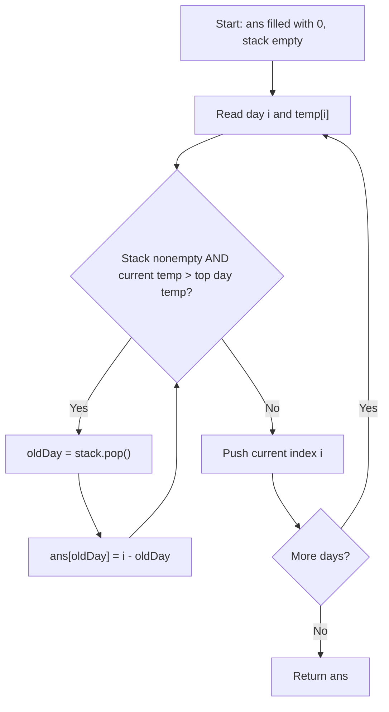
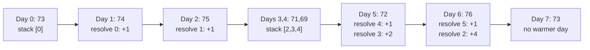
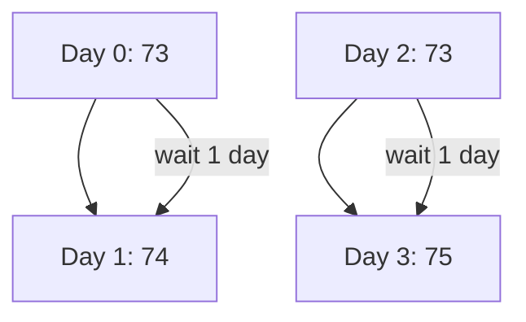

# 739. Daily Temperatures — Monotonic Stack

**LeetCode:** https://leetcode.com/problems/daily-temperatures/  
**Difficulty:** Medium  
**Status:** Solved  
**Pattern:** Monotonic decreasing stack of **indices**

## Problem

For each day, return how many days you must wait until a **strictly warmer** temperature. Return `0` when no warmer day exists.

Example:

```text
temperatures = [73,74,75,71,69,72,76,73]
answer       = [ 1, 1, 4, 2, 1, 1, 0, 0]
```

## My final solution (original code, unchanged)

```javascript
/**
 * @param {number[]} temperatures
 * @return {number[]}
 */
var dailyTemperatures = function(temperatures) {
    let temp = temperatures;
    let stack = [];
    let ans = new Array(temp.length).fill(0);

    for(let i = 0; i < temp.length; i++){
        let curr = temp[i];
        if(stack.length == 0 || curr < temp[stack[stack.length - 1]]){
            stack.push(i);
        }else{
            while(stack.length && curr > temp[stack[stack.length - 1]] ){
                let topDayIndex = stack.pop();
                ans[topDayIndex] = i - topDayIndex;
            }
            stack.push(i);
        }
    }
    // console.log(map);

    return ans;
   
}
```

## Explanation in simple Hinglish

- `stack` में **temperature नहीं, day index** रखो।
- `temp[stack[stack.length - 1]]` = stack के top index का temperature।
- अगर current temperature top वाले दिन से **ज्यादा** है, तो उस पुराने दिन का warmer day मिल गया।
- `topDayIndex = stack.pop()` के बाद `ans[topDayIndex] = i - topDayIndex` लिखो।
- `while` इसलिए है क्योंकि एक गर्म दिन **कई** पुराने दिनों का answer दे सकता है।
- अंत में जिन indices के लिए warmer day नहीं मिला, उनका answer `0` ही रहेगा।

**Equal temperatures:** जब `curr === temp[topIndex]` होता है, `while` नहीं चलता और current index push होता है। यह सही है क्योंकि equal temperature warmer नहीं है।

## Graphic 1 — algorithm flow



## Graphic 2 — dry run



| Day `i` | Temp | Action | Stack (bottom → top, indices) | Answer updates |
|---|---:|---|---|---|
| 0 | 73 | push 0 | `[0]` | — |
| 1 | 74 | pop 0; push 1 | `[1]` | `ans[0] = 1` |
| 2 | 75 | pop 1; push 2 | `[2]` | `ans[1] = 1` |
| 3 | 71 | push 3 | `[2,3]` | — |
| 4 | 69 | push 4 | `[2,3,4]` | — |
| 5 | 72 | pop 4 and 3; push 5 | `[2,5]` | `ans[4] = 1, ans[3] = 2` |
| 6 | 76 | pop 5 and 2; push 6 | `[6]` | `ans[5] = 1, ans[2] = 4` |
| 7 | 73 | push 7 | `[6,7]` | — |

Final: `[1,1,4,2,1,1,0,0]`.

## Graphic 3 — why we store indices



Repeated temperatures are allowed. In general, two days with the same temperature may have **different wait times**, so a map keyed only by temperature is incorrect.

Example: `[73,74,73,75]` has answer `[1,2,1,0]`: both 73s happen to wait one day, but their day indices must still be tracked separately. A clearer different-wait example: `[73,72,73,74]` gives `[3,1,1,0]`, and the two 73s have waits `3` and `1`.

## Complexity

- **Time:** O(n). Each index is pushed once and popped at most once, even though a `while` loop is nested inside the `for`.
- **Auxiliary space:** O(n) for the stack. The required output array also uses O(n).

## Edge cases

- `[30]` → `[0]`
- `[30,40,50,60]` → `[1,1,1,0]`
- `[60,50,40]` → `[0,0,0]`
- `[70,70,71]` → `[2,1,0]`
- `[73,72,73,74]` → `[3,1,1,0]`

## Optional simplification (not replacing my original)

The `if/else` is optional. Always run the `while` and then push the index:

```javascript
for (let i = 0; i < temperatures.length; i++) {
    while (stack.length && temperatures[i] > temperatures[stack[stack.length - 1]]) {
        const prevDay = stack.pop();
        ans[prevDay] = i - prevDay;
    }
    stack.push(i);
}
```

[← Section README](./README.md) · [Practice Sheet](./PRACTICE-SHEET.md)
