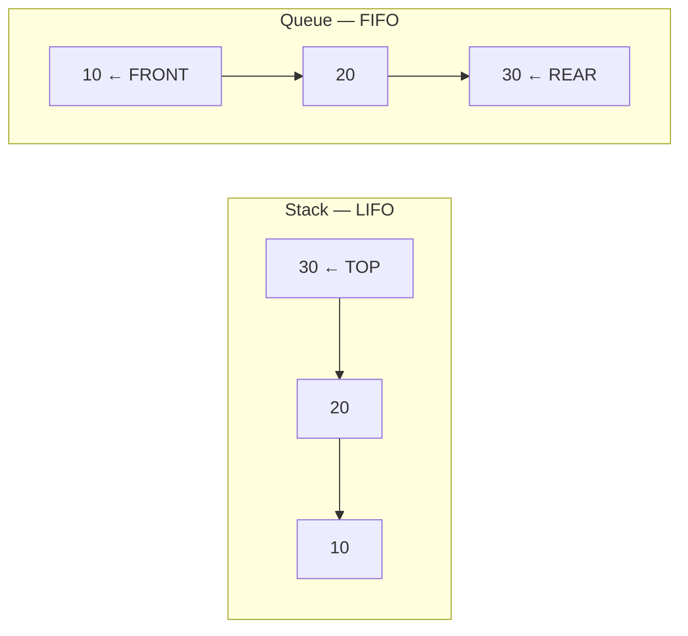

# Stack & Queue — Practice Sheet

> JavaScript | Learn patterns, solve problems, then revise. Mark a checkbox only after solving independently.

## Progress
- **Solved:** 6 / 30
- **Solved:** [225. Implement Stack using Queues](./225-implement-stack-using-queues.md), [20. Valid Parentheses](./20-valid-parentheses.md), [155. Min Stack](./155-min-stack.md), [150. Evaluate Reverse Polish Notation](./150-evaluate-reverse-polish-notation.md), [496. Next Greater Element I](./496-next-greater-element-i.md), [739. Daily Temperatures](./739-daily-temperatures.md)
- **Practiced (retry pending):** [232. Implement Queue using Stacks](./232-implement-queue-using-stacks.md)
- Suggested order: Basics → Stack patterns → Monotonic stack → Queue / Deque.

## Mental model

- **Stack:** Last In, First Out — `push`, `pop`, `top`.
- **Queue:** First In, First Out — `enqueue`, `dequeue`, `front`.
- JS arrays can simulate both, but `shift()` is O(n) in the worst case.

## A. Stack basics (1–10)

| Done | # | Problem | Difficulty | Pattern |
|---|---|---|---|---|
| [x] | 1 | [225. Implement Stack using Queues](https://leetcode.com/problems/implement-stack-using-queues/) | Easy | Queue rotation |
| [ ] | 2 | [232. Implement Queue using Stacks](./232-implement-queue-using-stacks.md) ([LeetCode](https://leetcode.com/problems/implement-queue-using-stacks/)) | Easy | Two stacks; retry |
| [x] | 3 | [20. Valid Parentheses](./20-valid-parentheses.md) ([LeetCode](https://leetcode.com/problems/valid-parentheses/)) | Easy | Matching brackets |
| [x] | 4 | [155. Min Stack](./155-min-stack.md) ([LeetCode](https://leetcode.com/problems/min-stack/)) | Medium | Auxiliary min / pairs |
| [ ] | 5 | [682. Baseball Game](https://leetcode.com/problems/baseball-game/) | Easy | Stack simulation |
| [ ] | 6 | [1047. Remove All Adjacent Duplicates in String](https://leetcode.com/problems/remove-all-adjacent-duplicates-in-string/) | Easy | Cancellation |
| [x] | 7 | [150. Evaluate Reverse Polish Notation](./150-evaluate-reverse-polish-notation.md) ([LeetCode](https://leetcode.com/problems/evaluate-reverse-polish-notation/)) | Medium | Expression evaluation |
| [ ] | 8 | [71. Simplify Path](https://leetcode.com/problems/simplify-path/) | Medium | Path components |
| [ ] | 9 | [394. Decode String](https://leetcode.com/problems/decode-string/) | Medium | Nested stack |
| [ ] | 10 | [735. Asteroid Collision](https://leetcode.com/problems/asteroid-collision/) | Medium | Simulation |

## B. Monotonic stack (11–20)

| Done | # | Problem | Difficulty | Pattern |
|---|---|---|---|---|
| [x] | 11 | [496. Next Greater Element I](./496-next-greater-element-i.md) ([LeetCode](https://leetcode.com/problems/next-greater-element-i/)) | Easy | Next greater |
| [x] | 12 | [739. Daily Temperatures](./739-daily-temperatures.md) ([LeetCode](https://leetcode.com/problems/daily-temperatures/)) | Medium | Decreasing stack |
| [ ] | 13 | [503. Next Greater Element II](https://leetcode.com/problems/next-greater-element-ii/) | Medium | Circular array |
| [ ] | 14 | [901. Online Stock Span](https://leetcode.com/problems/online-stock-span/) | Medium | Previous greater |
| [ ] | 15 | [1475. Final Prices With a Special Discount in a Shop](https://leetcode.com/problems/final-prices-with-a-special-discount-in-a-shop/) | Easy | Next smaller |
| [ ] | 16 | [402. Remove K Digits](https://leetcode.com/problems/remove-k-digits/) | Medium | Greedy stack |
| [ ] | 17 | [316. Remove Duplicate Letters](https://leetcode.com/problems/remove-duplicate-letters/) | Medium | Greedy monotonic |
| [ ] | 18 | [84. Largest Rectangle in Histogram](https://leetcode.com/problems/largest-rectangle-in-histogram/) | Hard | Boundaries |
| [ ] | 19 | [42. Trapping Rain Water](https://leetcode.com/problems/trapping-rain-water/) | Hard | Monotonic stack |
| [ ] | 20 | [85. Maximal Rectangle](https://leetcode.com/problems/maximal-rectangle/) | Hard | Histogram extension |

## C. Queue, deque & BFS (21–30)

| Done | # | Problem | Difficulty | Pattern |
|---|---|---|---|---|
| [ ] | 21 | [933. Number of Recent Calls](https://leetcode.com/problems/number-of-recent-calls/) | Easy | Sliding queue |
| [ ] | 22 | [1700. Number of Students Unable to Eat Lunch](https://leetcode.com/problems/number-of-students-unable-to-eat-lunch/) | Easy | Queue simulation |
| [ ] | 23 | [2073. Time Needed to Buy Tickets](https://leetcode.com/problems/time-needed-to-buy-tickets/) | Easy | Queue simulation |
| [ ] | 24 | [950. Reveal Cards In Increasing Order](https://leetcode.com/problems/reveal-cards-in-increasing-order/) | Medium | Index queue |
| [ ] | 25 | [649. Dota2 Senate](https://leetcode.com/problems/dota2-senate/) | Medium | Two queues |
| [ ] | 26 | [622. Design Circular Queue](https://leetcode.com/problems/design-circular-queue/) | Medium | Circular buffer |
| [ ] | 27 | [641. Design Circular Deque](https://leetcode.com/problems/design-circular-deque/) | Medium | Double-ended queue |
| [ ] | 28 | [239. Sliding Window Maximum](https://leetcode.com/problems/sliding-window-maximum/) | Hard | Monotonic deque |
| [ ] | 29 | [994. Rotting Oranges](https://leetcode.com/problems/rotting-oranges/) | Medium | Multi-source BFS |
| [ ] | 30 | [1926. Nearest Exit from Entrance in Maze](https://leetcode.com/problems/nearest-exit-from-entrance-in-maze/) | Medium | BFS queue |

## Revision checklist
- [ ] Explain LIFO vs FIFO without looking at notes.
- [ ] Implement a stack and a queue in JavaScript.
- [ ] Explain why rotating a queue simulates a stack.
- [ ] Recognize next-greater/next-smaller monotonic-stack patterns.
- [ ] Recognize when a deque or BFS queue is needed.
- [ ] Re-solve missed problems after 3 and 7 days.

> Note: Queue operations are usually assumed O(1) in algorithm analysis; JavaScript `Array.shift()` can be O(n). For performance-sensitive queues, use a head index or circular buffer.
