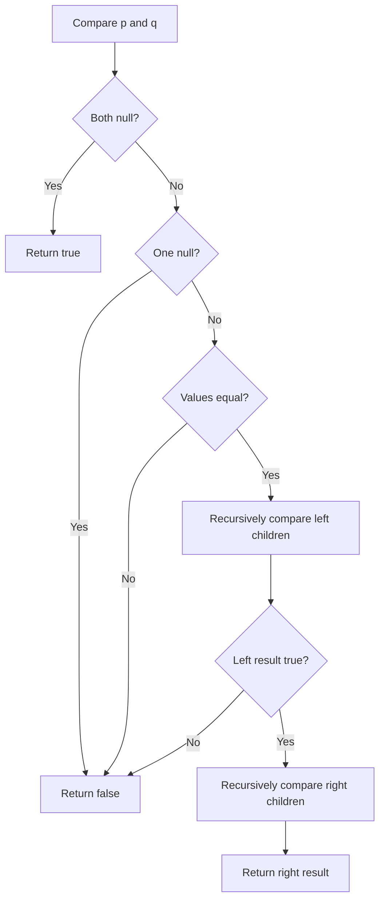
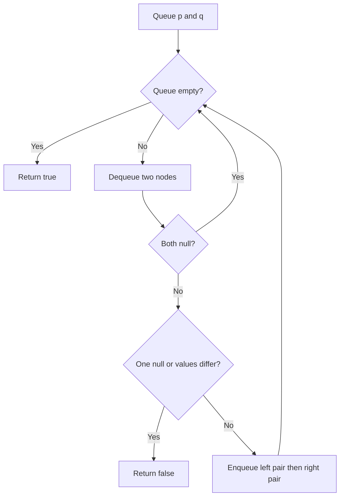

# 100. Same Tree — Recursive DFS and Iterative BFS

[← Trees & BST sheet](README.md) · [LeetCode 100](https://leetcode.com/problems/same-tree/)

**Pattern:** Pairwise tree comparison. Two binary trees are the same only when their **node values and structure** match at every corresponding position.

## Visual example

```text
Same:                    Different structure:
Tree P     Tree Q        Tree P      Tree Q
   1          1             1           1
  / \        / \           /             \
 2   3      2   3         2               2

Both left-to-left and right-to-right must match.
```

## Approach 1 — Your recursive DFS

Your corrected code:

```js
var isSameTree = function(p, q) {
    if (!p && !q) return true;
    if (!p || !q) return false;

    return (p.val === q.val) &&
           isSameTree(p.left, q.left) &&
           isSameTree(p.right, q.right);
};
```

### Explanation

1. Both `p` and `q` are null: corresponding positions match; return `true`.
2. Exactly one is null: shapes differ; return `false`.
3. Both exist: values must match, and **both left subtrees** and **both right subtrees** must be the same.
4. JavaScript `&&` short-circuits: a mismatch immediately propagates `false`, skipping later checks.

### Recursive call tree and return-value flow

```text
Tree P             Tree Q
    1                  1
   / \                / \
  2   3              2   3

isSameTree(1,1)
├── values 1 === 1 → true
├── isSameTree(2,2)
│   ├── values 2 === 2 → true
│   ├── isSameTree(null,null) → true
│   └── isSameTree(null,null) → true
│   ↳ return true
└── isSameTree(3,3)
    ├── values 3 === 3 → true
    ├── isSameTree(null,null) → true
    └── isSameTree(null,null) → true
    ↳ return true

Parent (1,1) receives true and true.
Final: true && true && true → true
```

**False propagation example:**

```text
isSameTree(1,1)
└── isSameTree(2,4)
    └── 2 !== 4 → return false
↳ parent returns false; right subtree comparison is skipped.
```

### Recursive flowchart



**Time:** O(n) worst case, where n is the total number of nodes across the two trees. **Auxiliary space:** O(h) recursion depth, where h is the maximum height of the compared trees; O(log n) for balanced and O(n) for skewed trees.

## Approach 2 — Your iterative BFS using a queue

Your code (same logic; descriptive variable names to avoid shadowing the input parameters):

```js
var isSameTree = function(p, q) {
    let que = [p, q];

    while (que.length) {
        let p1 = que.shift();
        let q1 = que.shift();

        if (!p1 && !q1) continue;
        if (!p1 || !q1) return false;

        if (p1.val !== q1.val) return false;

        que.push(p1.left, q1.left);
        que.push(p1.right, q1.right);
    }

    return true;
};
```

### Why queue pairs work

Each consecutive pair in the queue represents **the same position** in the two trees:

```text
Tree P:         Tree Q:
    p              q
   / \            / \
 pL   pR        qL   qR

Queue order: [pL, qL, pR, qR]
             left pair, right pair
```

Keep nulls in the queue: they detect a missing node on one side. Do **not** enqueue only non-null children, because that can hide structural mismatches.

### BFS queue dry run

```text
Tree P:   1         Tree Q:   1
         / \                 / \
        2   3               2   3

Initial queue: [P1, Q1]

Iteration 1: pop (P1,Q1), 1 === 1
  push (P2,Q2), (P3,Q3)
  queue: [P2,Q2,P3,Q3]

Iteration 2: pop (P2,Q2), 2 === 2
  push (null,null), (null,null)
  queue: [P3,Q3,null,null,null,null]

Iteration 3: pop (P3,Q3), 3 === 3
  push (null,null), (null,null)
  queue: [null,null,null,null,null,null,null,null]

Iterations 4–7: pop (null,null) → continue
Queue empty → return true
```

| Dequeued pair | Meaning | Action |
|---|---|---|
| `(null,null)` | Matching missing positions | Continue |
| `(null,node)` or `(node,null)` | Different shapes | Return false |
| Non-null unequal values | Different values | Return false |
| Non-null equal values | Matching so far | Push corresponding left and right pairs |

### Iterative flowchart



**Time:** O(n) pair comparisons; using JavaScript `Array.shift()` can cause O(n²) worst-case time. **Auxiliary queue:** O(w) entries, with w the maximum combined width of compared tree levels, including null positions. Replacing `shift()` with a head index makes traversal O(n) time (while retaining O(n) allocated queue entries).

## Comparison

| Feature | Recursive DFS | Iterative BFS |
|---|---|---|
| Processing | Depth first | Breadth first |
| Match | Values and corresponding left/right subtrees | Values and corresponding queued pairs |
| Early exit | `&&` short-circuit | `return false` |
| Time | O(n) | O(n) logical, `shift()` overhead |
| Extra space | O(h) call stack | O(w) active queue |

## Corner cases

| Input | Expected |
|---|---|
| Both trees null | `true` |
| Only one tree null | `false` |
| Single nodes, same value | `true` |
| Single nodes, different values | `false` |
| Same values but left/right placements differ | `false` |
| Same shape but one deeper value differs | `false` |
| Both identical with duplicate values | `true` |

## Same Tree vs Symmetric Tree

| Same Tree (100) | Symmetric Tree (101) |
|---|---|
| Compare `p.left` with `q.left` | Compare left subtree's left with right subtree's right |
| Compare `p.right` with `q.right` | Compare left subtree's right with right subtree's left |
| Identical position comparison | Mirror position comparison |

**Interview memory trick:** Same Tree → **same side**; Symmetric Tree → **opposite side**.

**Mistake you corrected:** `if (!p || !p)` checks the same variable twice. It must be `if (!p || !q)` so a null second node cannot cause an invalid `q.val` access.
