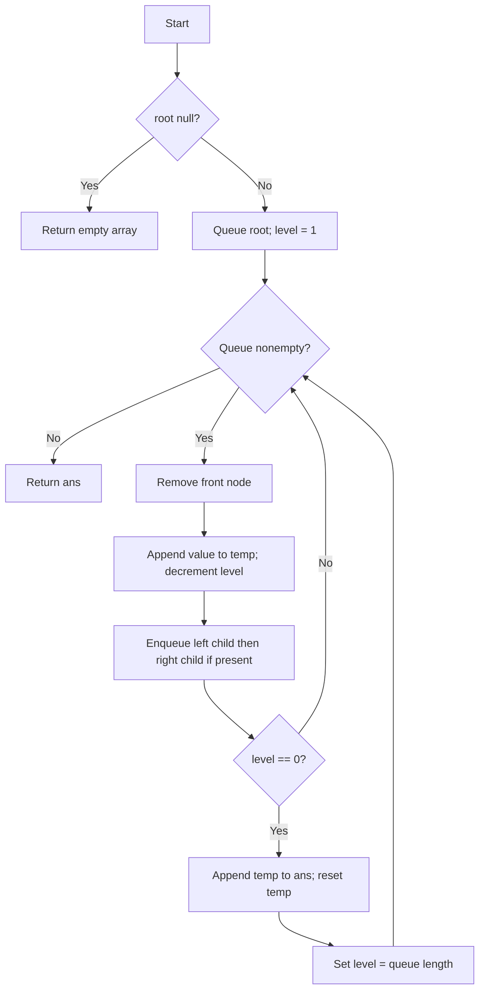

# 102. Binary Tree Level Order Traversal (BFS)

[← Trees & BST sheet](README.md) · [LeetCode 102](https://leetcode.com/problems/binary-tree-level-order-traversal/)

**Difficulty:** Medium · **Pattern:** BFS / Queue · **Status:** User-provided working solution

## Problem

Given the root of a binary tree, return its node values **level by level**, from left to right, as a nested array.

```text
          3
         / \
        9   20
           /  \
          15   7
```

**Input:** `[3,9,20,null,null,15,7]`  
**Output:** `[[3],[9,20],[15,7]]`

## Approach 1 — Your solution: Queue + remaining nodes counter

```js
var levelOrder = function(root) {
    let q = [root];
    let ans = [];
    if(!root) return ans;

    let temp =[];
    let level = 1;
    while(q.length){
        let curr = q.shift();
        temp.push(curr.val);
        level--;

        curr.left && q.push(curr.left);
        curr.right && q.push(curr.right);

        if(level == 0){
           ans.push(temp);
           temp =[];
           level = q.length;
        }
    }
    return ans;
};
```

### Idea

- `q` is a **FIFO queue**: remove the oldest node and append its children (left first, then right).
- `temp` collects values from the **current level**.
- `level` means **how many nodes remain to be processed in the current level**, not the tree depth.
- Initially, `level = 1` because only the root is in level 0.
- Each processed node decreases `level` by one.
- When `level == 0`, the current level is complete: append `temp` to `ans`, reset `temp`, and set `level = q.length` to count nodes in the next level.
- **Why `q.length` works:** when the last node of a level is processed, every node of that level has been removed; only its children's level remains in the queue.

### Dry run

| Removed node | Queue after adding children | `level` after decrement | Action |
|---|---|---:|---|
| 3 | [9,20] | 0 | Save [3]; next level count = 2 |
| 9 | [20] | 1 | Continue |
| 20 | [15,7] | 0 | Save [9,20]; next level count = 2 |
| 15 | [7] | 1 | Continue |
| 7 | [] | 0 | Save [15,7]; next level count = 0 |

```text
Queue flow:
[3] → [9,20] → [20] → [15,7] → [7] → []
Answer:
[[3]] → [[3],[9,20]] → [[3],[9,20],[15,7]]
```

### Flowchart



### Important pitfalls

1. `if (level = 0)` is **assignment**, not comparison; use `=== 0` or `== 0`.
2. Enqueue left **before** right to preserve left-to-right order.
3. Reset `temp` after saving a level.
4. Check `!root` before trying to read node properties.
5. In JavaScript, repeated `Array.shift()` may cost O(n) per operation because remaining elements move.

### Complexity

- **Algorithmic BFS work:** O(n) node visits.
- **Actual JavaScript implementation with `shift()`:** O(n²) worst-case time due to array shifting.
- **Auxiliary queue + current-level array:** O(w), where `w` is maximum tree width.
- **Output:** O(n) additional storage.

## Approach 2 — Efficient queue with head index

Same **remaining-nodes counter** logic, but avoid costly `shift()`.

```js
var levelOrder = function(root) {
    if (!root) return [];

    const q = [root];
    const ans = [];
    let head = 0;
    let temp = [];
    let level = 1;

    while (head < q.length) {
        const curr = q[head++];
        temp.push(curr.val);
        level--;

        if (curr.left) q.push(curr.left);
        if (curr.right) q.push(curr.right);

        if (level === 0) {
            ans.push(temp);
            temp = [];
            level = q.length - head;
        }
    }

    return ans;
};
```

Here the number of **unprocessed** nodes is `q.length - head`, not `q.length`, because the queue array retains processed elements.

**Time:** O(n). **Auxiliary allocated queue array:** O(n) (processed entries are retained). **Output:** O(n).

## Corner cases

| Tree | Result |
|---|---|
| `null` | `[]` |
| Single node `1` | `[[1]]` |
| Root with only left child `1 → 2` | `[[1],[2]]` |
| Root with only right child `1 → 2` | `[[1],[2]]` |
| Skewed tree `1 → 2 → 3` | `[[1],[2],[3]]` |
| Duplicate values | Preserve all node occurrences |
| Negative and zero values | Preserve values normally |

**Interview note:** DFS goes depth-first (preorder/inorder/postorder). This problem requires **BFS**, visiting one complete level before the next.
