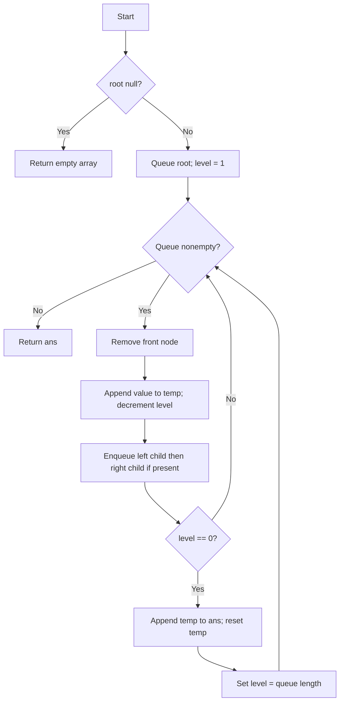
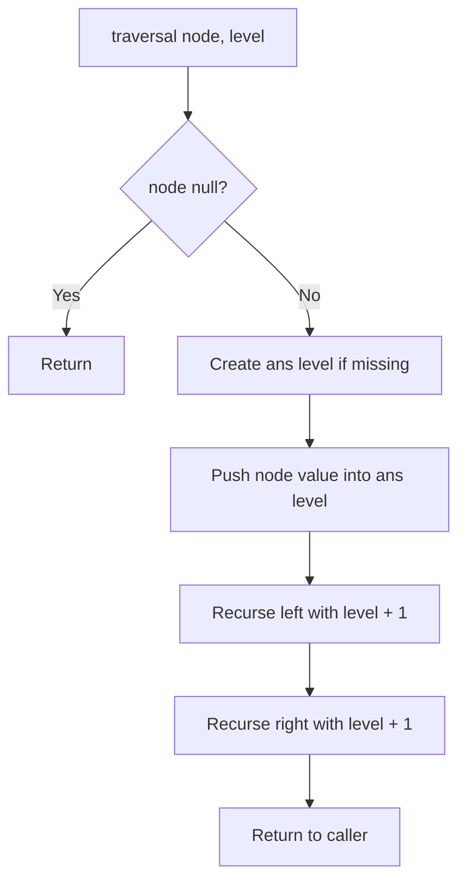

# 102. Binary Tree Level Order Traversal — BFS and DFS

[← Trees & BST sheet](README.md) · [LeetCode 102](https://leetcode.com/problems/binary-tree-level-order-traversal/)

**Difficulty:** Medium · **Patterns:** BFS (queue), DFS (recursion + depth index) · **Status:** Three user-provided solutions saved

## Problem

Given the root of a binary tree, return its node values **level by level**, from left to right, as a nested array.

```text
          3
         / \
        9   20
           /  \
          15   7
```

**Input:** `[3,9,20,null,null,15,7]`  
**Output:** `[[3],[9,20],[15,7]]`

## Approach 1 — Your solution: Queue + remaining nodes counter

```js
var levelOrder = function(root) {
    let q = [root];
    let ans = [];
    if(!root) return ans;

    let temp =[];
    let level = 1;
    while(q.length){
        let curr = q.shift();
        temp.push(curr.val);
        level--;

        curr.left && q.push(curr.left);
        curr.right && q.push(curr.right);

        if(level == 0){
           ans.push(temp);
           temp =[];
           level = q.length;
        }
    }
    return ans;
};
```

### Idea

- `q` is a **FIFO queue**: remove the oldest node and append its children (left first, then right).
- `temp` collects values from the **current level**.
- `level` means **how many nodes remain to be processed in the current level**, not the tree depth.
- Initially, `level = 1` because only the root is in level 0.
- Each processed node decreases `level` by one.
- When `level == 0`, the current level is complete: append `temp` to `ans`, reset `temp`, and set `level = q.length` to count nodes in the next level.
- **Why `q.length` works:** when the last node of a level is processed, every node of that level has been removed; only its children's level remains in the queue.

### Dry run

| Removed node | Queue after adding children | `level` after decrement | Action |
|---|---|---:|---|
| 3 | [9,20] | 0 | Save [3]; next level count = 2 |
| 9 | [20] | 1 | Continue |
| 20 | [15,7] | 0 | Save [9,20]; next level count = 2 |
| 15 | [7] | 1 | Continue |
| 7 | [] | 0 | Save [15,7]; next level count = 0 |

```text
Queue flow:
[3] → [9,20] → [20] → [15,7] → [7] → []
Answer:
[[3]] → [[3],[9,20]] → [[3],[9,20],[15,7]]
```

### Flowchart



### Important pitfalls

1. `if (level = 0)` is **assignment**, not comparison; use `=== 0` or `== 0`.
2. Enqueue left **before** right to preserve left-to-right order.
3. Reset `temp` after saving a level.
4. Check `!root` before trying to read node properties.
5. In JavaScript, repeated `Array.shift()` may cost O(n) per operation because remaining elements move.

### Complexity

- **Algorithmic BFS work:** O(n) node visits.
- **Actual JavaScript implementation with `shift()`:** O(n²) worst-case time due to array shifting.
- **Auxiliary queue + current-level array:** O(w), where `w` is maximum tree width.
- **Output:** O(n) additional storage.

## Optimization of Approach 1 — Efficient queue with head index

Same **remaining-nodes counter** logic, but avoid costly `shift()`.

```js
var levelOrder = function(root) {
    if (!root) return [];

    const q = [root];
    const ans = [];
    let head = 0;
    let temp = [];
    let level = 1;

    while (head < q.length) {
        const curr = q[head++];
        temp.push(curr.val);
        level--;

        if (curr.left) q.push(curr.left);
        if (curr.right) q.push(curr.right);

        if (level === 0) {
            ans.push(temp);
            temp = [];
            level = q.length - head;
        }
    }

    return ans;
};
```

Here the number of **unprocessed** nodes is `q.length - head`, not `q.length`, because the queue array retains processed elements.

**Time:** O(n). **Auxiliary allocated queue array:** O(n) (processed entries are retained). **Output:** O(n).

## Approach 2 — Your standard BFS: fixed queue size + for loop (recommended iterative)

```js
var levelOrder = function(root) {
  let ans = [];
  let q = [root];
  if(!root) return ans;

  while(q.length){
    let levelArr = [];
    let qSize = q.length;
    for(let i = 0; i < qSize; i++){
        let curr = q.shift();
        levelArr.push(curr.val);
        curr.left && q.push(curr.left);
        curr.right && q.push(curr.right);
    }
    ans.push(levelArr);
  }
  return ans;
};
```

### Why this works

- **Outer while loop** handles one level per iteration.
- **`qSize = q.length`** snapshots the number of nodes in the current level.
- **Inner for loop** processes exactly `qSize` nodes, even though pushing children changes the queue's actual length.
- Left child is enqueued before right child, preserving left-to-right order.
- After the for loop, `levelArr` is complete and the queue contains only nodes of the next level.

### Level-by-level dry run

| While iteration | `qSize` | Nodes processed | Queue after loop | Appended level |
|---|---:|---|---|---|
| 1 | 1 | 3 | [9,20] | [3] |
| 2 | 2 | 9,20 | [15,7] | [9,20] |
| 3 | 2 | 15,7 | [] | [15,7] |

```text
Level 0:       3           → [3]
              / \
Level 1:     9   20        → [9,20]
                 / \
Level 2:        15  7      → [15,7]
```

**Complexity:** O(n) BFS operations; JavaScript `shift()` can make the implementation O(n²) worst-case. Auxiliary queue O(w), output O(n).

## Approach 3 — Your recursive DFS with level index

```js
var levelOrder = function(root) {
    if(!root) return [];
    let ans = [];
    //Recursive approach
    var traversal = function(curr , level){
        if(!curr) return;
        if(!ans[level]) ans[level] = [];
        ans[level].push(curr.val);
         traversal(curr.left , level + 1);
         traversal(curr.right, level + 1);
    }
    traversal(root , 0);
    return ans;
};
```

### Why DFS still produces level-order groups

This performs **preorder DFS** (node → left → right), not BFS. However, it writes each value into `ans[level]`, so nodes at the same depth are grouped. Visiting the left subtree before the right ensures the correct left-to-right ordering **within each level**.

### Recursive visit trace

```text
traversal(3, 0)  → ans[0] = [3]
  traversal(9, 1)  → ans[1] = [9]
  traversal(20, 1) → ans[1] = [9,20]
    traversal(15, 2) → ans[2] = [15]
    traversal(7, 2)  → ans[2] = [15,7]

DFS visit order: 3, 9, 20, 15, 7
Level-order output: [[3],[9,20],[15,7]]
```

For a more branched tree, DFS visit order can differ significantly from BFS order, but `ans[level]` still groups values correctly.

### Recursive call flowchart



**Complexity:** O(n) time, O(h) auxiliary recursion stack, O(n) output. On a highly skewed tree, recursion depth may reach n and can cause stack overflow.

## Comparison — which approach should you use?

| Approach | Technique | Time in this JS code | Auxiliary space | Interview use |
|---|---|---|---|---|
| 1: Remaining-level counter | BFS + queue | O(n²) worst-case with `shift()` | O(w) | Valid alternative |
| 2: Fixed `qSize` + for loop | BFS + queue | O(n²) worst-case with `shift()` | O(w) | **Preferred iterative approach** |
| 3: DFS + level index | Recursive preorder DFS | O(n) | O(h) | Clean recursive alternative |
| Head-index optimization | BFS + queue index | O(n) | O(n) allocated queue | Avoids `shift()` overhead |

**Important:** The first three are your own approaches. The head-index implementation is a performance optimization, not counted as a fourth original approach.

## Corner cases

| Tree | Result |
|---|---|
| `null` | `[]` |
| Single node `1` | `[[1]]` |
| Root with only left child `1 → 2` | `[[1],[2]]` |
| Root with only right child `1 → 2` | `[[1],[2]]` |
| Skewed tree `1 → 2 → 3` | `[[1],[2],[3]]` |
| Duplicate values | Preserve all node occurrences |
| Negative and zero values | Preserve values normally |

**Interview note:** Level-order **output** does not require a BFS **implementation**. BFS is the natural traversal, but DFS + depth indexing also produces the required nested level arrays.
