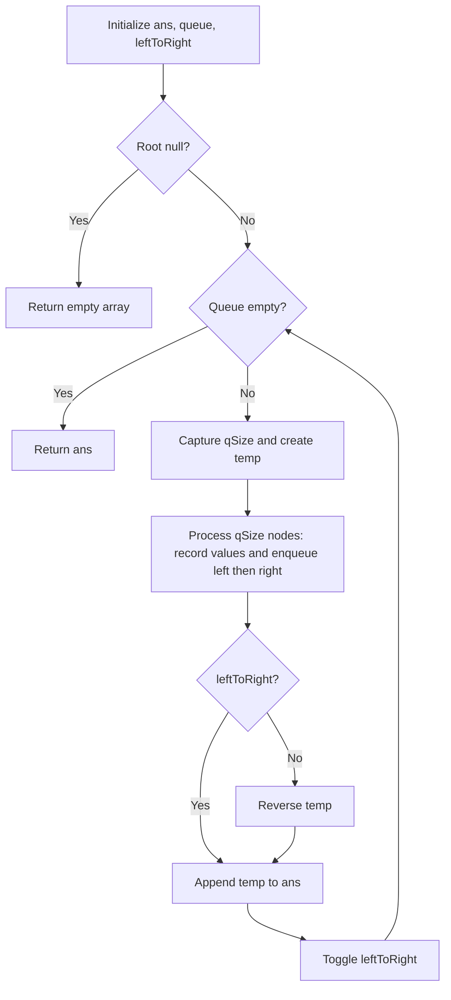

# 103. Binary Tree Zigzag Level Order Traversal

[← Trees & BST sheet](README.md) · [LeetCode 103](https://leetcode.com/problems/binary-tree-zigzag-level-order-traversal/)

**Pattern:** BFS + Queue + Level Size + Direction Toggle.

## Your corrected solution

```javascript
var zigzagLevelOrder = function(root) {
    let ans = [];
    if(!root) return ans;
    let leftToRight = true;

    let q = [root];
    while(q.length){
        let temp = [];
        let qSize = q.length;
        for(let i = 0; i < qSize ; i++){
            let curr = q.shift();
            temp.push(curr.val);
            curr.left && q.push(curr.left);
            curr.right && q.push(curr.right);
        }
        if (!leftToRight) {
            temp.reverse();
        }

        ans.push(temp);
        leftToRight = !leftToRight
    }
    return ans;
};
```

## Tree diagram and zigzag output

```text
                  1               Level 0:  → [1]
                 / \
                2   3             Level 1:  ← [3, 2]
               / \ / \
              4  5 6  7           Level 2:  → [4, 5, 6, 7]

Output: [[1], [3, 2], [4, 5, 6, 7]]
```

## Step-by-step explanation

1. If root is null, return `[]`.
2. Start queue with `root`; `leftToRight = true`.
3. At each level, save `qSize = q.length` **before** adding children, so exactly that level's nodes are processed.
4. For each current node, append its value to `temp`; enqueue its **left child first, then right child**.
5. If `leftToRight` is false, reverse `temp`. This changes **output order only**, not the BFS traversal order.
6. Append `temp` to `ans` and toggle the direction.

### Queue dry run

```text
Initially: q=[1], leftToRight=true

Level 0:
  qSize=1, pop 1, temp=[1]
  enqueue 2,3 → q=[2,3]
  no reverse → ans=[[1]]
  leftToRight=false

Level 1:
  qSize=2, pop 2 → temp=[2], enqueue 4,5
  pop 3 → temp=[2,3], enqueue 6,7
  q=[4,5,6,7]
  reverse temp → [3,2]
  ans=[[1],[3,2]]
  leftToRight=true

Level 2:
  qSize=4, pop 4,5,6,7 → temp=[4,5,6,7]
  q=[]
  no reverse → ans=[[1],[3,2],[4,5,6,7]]

Return ans.
```

| Level | Queue order | Direction | Saved row |
|---|---|---|---|
| 0 | `[1]` | Left → right | `[1]` |
| 1 | `[2,3]` | Right → left | `[3,2]` |
| 2 | `[4,5,6,7]` | Left → right | `[4,5,6,7]` |

## Why the first attempt failed

Your first version enqueued **right child before left child at every level**:

```javascript
curr.right && q.push(curr.right);
curr.left && q.push(curr.left);
```

That yields `[[1],[3,2],[7,6,5,4]]` on the pictured tree, not the expected `[[1],[3,2],[4,5,6,7]]`.

**Fix:** Always enqueue left then right, and reverse the current level's output on alternate levels.

## Flowchart



## Complexity

- **Logical BFS traversal:** O(n), each node processed once.
- **All level reversals combined:** O(n).
- **JavaScript `Array.shift()` overhead:** Worst-case O(n²) total time, because shifting a long array can move many elements.
- **Auxiliary queue space:** O(w) for maximum tree width; **output:** O(n).

**Optional optimization:** Replace `shift()` with a head-index queue to achieve O(n) traversal time. Or avoid `reverse()` using `temp[leftToRight ? i : qSize - 1 - i] = curr.val` while processing each level.

## Corner cases

| Input | Output |
|---|---|
| `null` | `[]` |
| Single node `1` | `[[1]]` |
| Only left children | One value per level |
| Only right children | One value per level |
| Uneven tree | Alternate direction per existing level |
| Duplicate values | Preserve each value in its zigzag position |

**Interview takeaway:** Zigzag level order can be implemented as **normal left-to-right BFS with alternating output reversal**. The direction flag changes after each level, not after each node.
