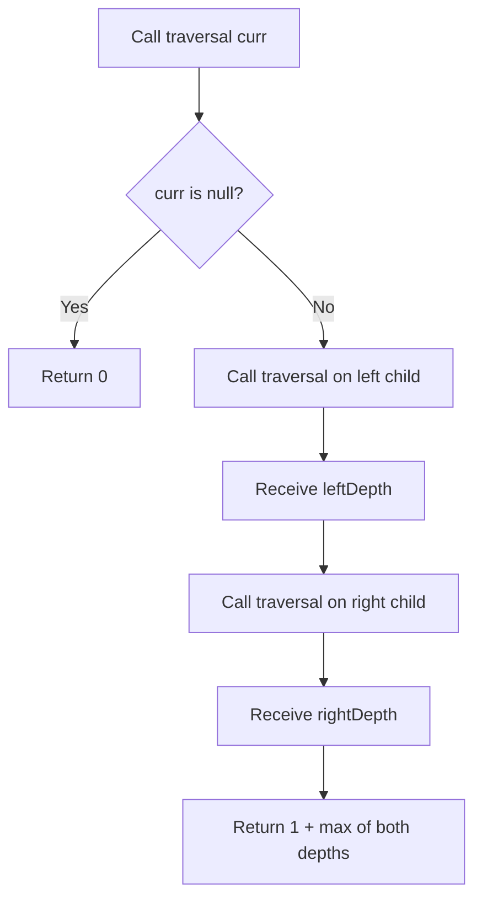

# 104. Maximum Depth of Binary Tree — Two Recursive DFS Approaches

[← Trees & BST sheet](README.md) · [LeetCode 104](https://leetcode.com/problems/maximum-depth-of-binary-tree/)

**Difficulty:** Easy · **Pattern:** DFS / Recursion · **Status:** Two user-provided solutions saved

## Problem and depth convention

Return the **maximum number of nodes** on a path from root to a deepest leaf. An empty tree has depth **0**, and a single node has depth **1**. (This differs from the edge-count height convention in tree theory.)

```text
              3
             / \
            9   20
               /  \
              15   7

Root-to-leaf paths: 3 → 9 (2 nodes)
                    3 → 20 → 15 (3 nodes)
                    3 → 20 → 7 (3 nodes)
Answer: 3
```

## Approach 1 — Your Top-Down DFS (pass level, track global maximum)

```js
var maxDepth = function(root) {
    if(!root) return 0;
    let maxDepth = 0;

    function traversal (curr , level){
        maxDepth = Math.max(maxDepth , level);
        curr.left && traversal(curr.left , level +1);
        curr.right && traversal(curr.right , level +1);
    }
    traversal(root ,1);
    return maxDepth;
};
```

### Idea

Start at root with `level = 1`. Every recursive descent increases the level by 1. Update the shared `maxDepth` at every visited node. No need to return a depth from `traversal`: it updates the outer variable.

### Top-down recursive call tree

```text
traversal(3, 1)          maxDepth = 1
├── traversal(9, 2)     maxDepth = 2
│   └── no children
└── traversal(20, 2)    maxDepth = 2
    ├── traversal(15, 3) maxDepth = 3
    │   └── no children
    └── traversal(7, 3)  maxDepth = 3
        └── no children

Final maxDepth = 3
```

### Dry run

| Call | `level` | `maxDepth` after update |
|---|---:|---:|
| traversal(3, 1) | 1 | 1 |
| traversal(9, 2) | 2 | 2 |
| traversal(20, 2) | 2 | 2 |
| traversal(15, 3) | 3 | 3 |
| traversal(7, 3) | 3 | 3 |

**Time:** O(n). **Auxiliary stack:** O(h), where h is maximum number of nodes on a root-to-leaf path. **Other extra state:** O(1).

## Approach 2 — Your Bottom-Up DFS (return height from each call)

```js
var maxDepth = function(root) {
    function traversal(curr){
        if(!curr) return 0;
        let leftDepth = traversal(curr.left);
        let rightDepth = traversal(curr.right);
        return 1 + Math.max(leftDepth ,rightDepth);
    }
    return traversal(root);
};
```

### Idea — understand the return

The function cannot compute a node's height until its **left and right recursive calls have returned**. `traversal(null)` returns `0`. Therefore a leaf node computes `1 + Math.max(0, 0) = 1`. Each parent adds 1 to the larger child height.

This is **postorder-style computation**: calculate left, calculate right, then calculate current node's result.

### A. Recursive call tree — calls go downward first

```text
traversal(3)
├── traversal(9)
│   ├── traversal(null) → 0
│   └── traversal(null) → 0
└── traversal(20)
    ├── traversal(15)
    │   ├── traversal(null) → 0
    │   └── traversal(null) → 0
    └── traversal(7)
        ├── traversal(null) → 0
        └── traversal(null) → 0
```

**Important:** JavaScript completes the left call before executing the right call. A parent is paused at `let leftDepth = traversal(curr.left)` until that subtree returns.

### B. Return-value tree — values bubble upward

```text
                   3  ← return 3
                  / \
      return 1 → 9   20 ← return 2
                       / \
          return 1 → 15  7 ← return 1

At 9:  left = 0, right = 0 → 1 + max(0,0) = 1
At 15: left = 0, right = 0 → 1 + max(0,0) = 1
At 7:  left = 0, right = 0 → 1 + max(0,0) = 1
At 20: left = 1, right = 1 → 1 + max(1,1) = 2
At 3:  left = 1, right = 2 → 1 + max(1,2) = 3
```

### C. Actual execution and returns — detailed trace

```text
1. traversal(3)
   → waits for traversal(9)
2.   traversal(9)
     → traversal(null) returns 0  [leftDepth = 0]
     → traversal(null) returns 0  [rightDepth = 0]
     → returns 1 to traversal(3)
3. traversal(3) now has leftDepth = 1
   → waits for traversal(20)
4.   traversal(20)
     → waits for traversal(15)
5.     traversal(15)
       → null returns 0, null returns 0
       → returns 1 to traversal(20)
6.   traversal(20) now has leftDepth = 1
     → waits for traversal(7)
7.     traversal(7)
       → null returns 0, null returns 0
       → returns 1 to traversal(20)
8.   traversal(20): leftDepth = 1, rightDepth = 1
     → returns 2 to traversal(3)
9. traversal(3): leftDepth = 1, rightDepth = 2
   → returns 3 to maxDepth caller
```

### D. Return calculation table

| Node | Left call returns | Right call returns | This call returns |
|---|---:|---:|---:|
| 9 | 0 | 0 | 1 |
| 15 | 0 | 0 | 1 |
| 7 | 0 | 0 | 1 |
| 20 | 1 | 1 | 2 |
| 3 | 1 | 2 | **3** |

### E. Flowchart



**Time:** O(n) because each node is visited once. **Auxiliary space:** O(h) recursion stack (balanced: O(log n), skewed: O(n)). No shared mutable maximum is required.

## Compare the two approaches

| Feature | Top-Down DFS | Bottom-Up DFS |
|---|---|---|
| Core idea | Track depth while descending | Return subtree heights while unwinding |
| Arguments | `curr, level` | `curr` |
| Base case | Outer `!root`; recurse only into existing children | Every null call returns `0` |
| Result | Shared `maxDepth` variable | Return value of `traversal(root)` |
| Return from helper | No meaningful return | Returns height of subtree |
| Time | O(n) | O(n) |
| Recursion stack | O(h) | O(h) |
| Interview choice | Correct and intuitive | **Recommended: concise, compositional** |

## Corner cases

| Input tree | Expected answer | Reason |
|---|---:|---|
| `null` | 0 | Empty tree |
| One node | 1 | Root is a leaf |
| Root + one child | 2 | Two nodes in longest path |
| Skewed chain of 4 nodes | 4 | All nodes on one path |
| Balanced tree of 7 nodes | 3 | Three levels |
| Unequal left and right depths | Larger depth | `Math.max` chooses longer path |

### Common mistakes

1. Confusing **edge height** with LeetCode's **node-count maximum depth**; do not start root at level 0 if you expect depth 1 for a leaf.
2. Forgetting `return 0` for a null node in bottom-up recursion.
3. Writing `Math.max(leftDepth, rightDepth)` without `+ 1` for the current node.
4. Thinking `traversal(curr.left)` and `traversal(curr.right)` return simultaneously; calls execute sequentially.
5. Assuming stack space O(log n) for every tree; skewed trees have O(n) depth.
6. Using `curr.val` truthiness to decide whether a node exists; zero-valued nodes are valid.

**Memory rule:** Top-down **carries depth into calls**; bottom-up **returns height out of calls**.
