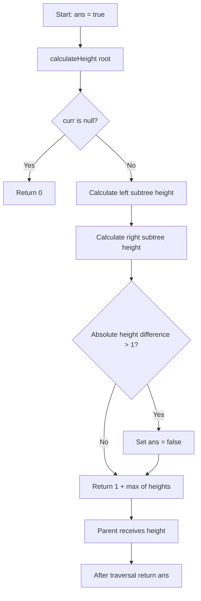

# 110. Balanced Binary Tree — Bottom-up DFS + Shared Boolean

[← Tree sheet](README.md) · [LeetCode 110](https://leetcode.com/problems/balanced-binary-tree/)

## Problem and rule

A binary tree is **height-balanced** when **every node** has left and right subtree heights differing by **at most 1**.

```text
Balanced:                Unbalanced:
      1                       1
     / \                     /
    2   3                   2
   /                       /
  4                       3

At root: |2 - 1| = 1    At root: |2 - 0| = 2
```

## Approach 1 — Your solution (Bottom-up DFS + shared boolean)

```javascript
var isBalanced = function(root) {
   let ans = true;
   function calculateHeight(curr){
        if(!curr) return 0;
        let leftHeight = calculateHeight(curr.left);
        let rightHeight = calculateHeight(curr.right);

        // before returning the height, check if the
        // left and right subtrees are height-balanced
        if(Math.abs(leftHeight - rightHeight) > 1){
            ans = ans && false;
        }
        return 1 + Math.max(leftHeight , rightHeight);
   }
   calculateHeight(root);
   return ans;
};
```

**Note:** This preserves your logic. `ans = ans && false` is equivalent to simply `ans = false` inside the condition. The latter is shorter.

### How it works

1. Start with `ans = true`: assume the whole tree is balanced.
2. `calculateHeight(null)` returns height `0`.
3. DFS recursively calculates **left height** and **right height** before processing the current node.
4. If `Math.abs(leftHeight - rightHeight) > 1`, set shared `ans` to `false`.
5. Return `1 + Math.max(leftHeight, rightHeight)` to the parent.
6. After traversing all nodes, return `ans`.

**Important:** The helper returns a **number (height)**, not a boolean. The outer `ans` stores whether *any* node failed the balance test. Once false, it never becomes true.

## Bottom-up recursion diagram and dry run

```text
          1
         / \
        2   3
       /
      4
     /
    5

Calls descend:
height(1)
├── height(2)
│   ├── height(4)
│   │   ├── height(5)
│   │   │   ├── height(null) → 0
│   │   │   └── height(null) → 0
│   │   │   ↳ |0-0|=0, return 1
│   │   └── height(null) → 0
│   │   ↳ |1-0|=1, return 2
│   └── height(null) → 0
│   ↳ |2-0|=2 → ans=false, return 3
└── height(3)
    ├── height(null) → 0
    └── height(null) → 0
    ↳ |0-0|=0, return 1

At root 1: |3-1|=2 → ans=false, return height 4
Final isBalanced(root) → false
```

| Node (return order) | Left height | Right height | Difference | Returned height | Shared ans |
|---|---:|---:|---:|---:|---|
| 5 | 0 | 0 | 0 | 1 | true |
| 4 | 1 | 0 | 1 | 2 | true |
| 2 | 2 | 0 | 2 | 3 | false |
| 3 | 0 | 0 | 0 | 1 | false |
| 1 | 3 | 1 | 2 | 4 | false |

**Why bottom-up?** Recursive calls go downward, but the height is computed and the balance test happens **on return** from the children. This is postorder DFS (left → right → current).

## Flowchart



## Complexity

- **Time:** O(n), each node is visited once, even after `ans` becomes false.
- **Auxiliary space:** O(h) recursive call stack, where h is tree height.
- Balanced tree stack: O(log n); skewed tree stack: O(n).

## Corner cases

| Input | Expected | Reason |
|---|---|---|
| `root = null` | `true` | No imbalance; helper returns 0 |
| Single node | `true` | Both subtree heights 0 |
| Two-node chain | `true` | Height difference 1 |
| Three-node chain | `false` | Root difference 2 |
| Perfect binary tree | `true` | All nodes balanced |
| Root balanced but a descendant unbalanced | `false` | **Every** node must pass |

## Interview notes

- **Maximum Depth of Binary Tree (104)** returns `1 + Math.max(leftHeight, rightHeight)`. This solution adds the balance check before returning the same height.
- A different optimized solution returns `-1` as a sentinel as soon as an unbalanced subtree is found, enabling early termination. Your shared-boolean solution is already correct and O(n).
- Avoid checking only the root's height difference: a deeper subtree may be unbalanced while the root appears balanced.
