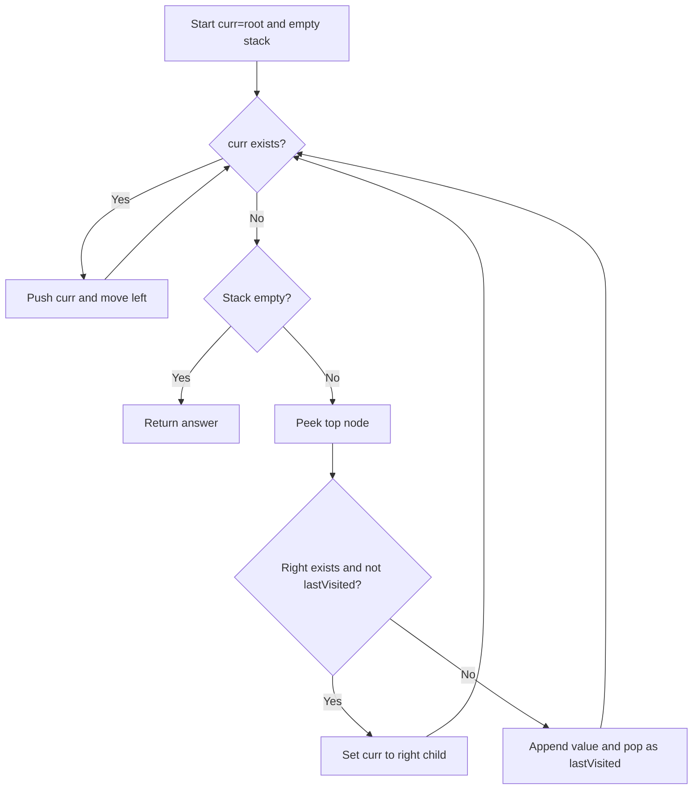

# 145. Binary Tree Postorder Traversal — Recursive DFS

**Status:** ✅ Solved independently · **Difficulty:** Easy · **Pattern:** DFS / Recursion  
[LeetCode 145](https://leetcode.com/problems/binary-tree-postorder-traversal/) · [← Tree sheet](README.md)

## 1. Problem

Given a binary tree root, return its node values in **postorder: Left → Right → Root**.

Unlike preorder or inorder, we append the current node **only after both subtrees finish**.

## 2. Your original JavaScript solution

```js
var postorderTraversal = function(root) {
    let ans =[];
    function treeTraversal(curr){
        if(!curr) return;
        treeTraversal(curr.left);
        treeTraversal(curr.right);
        ans.push(curr.val);
    }
    treeTraversal(root);
    return ans;
};
```

- `if (!curr) return;` stops at missing children.
- `treeTraversal(curr.left)` finishes the entire left subtree.
- `treeTraversal(curr.right)` finishes the entire right subtree.
- `ans.push(curr.val)` runs **last**, when control returns to the current frame.
- All calls share one `ans` array through the nested function's closure.

## 3. Tree diagram

```text
                  A
                /   \
               B     C
              /     / \
             D     E   F
                    \
                     G
```

**Expected output:** `[D, B, G, E, F, C, A]`

## 4. Complete recursion execution — going down and coming back

```text
treeTraversal(A)                         (A waits for left and right)
│
├─ LEFT: treeTraversal(B)                (B waits for left and right)
│  ├─ LEFT: treeTraversal(D)
│  │  ├─ LEFT: null → return
│  │  ├─ RIGHT: null → return
│  │  └─ PUSH D                          ans = [D]
│  │     ↳ return to B
│  ├─ RIGHT: null → return
│  └─ PUSH B                             ans = [D,B]
│     ↳ return to A
│
├─ RIGHT: treeTraversal(C)
│  ├─ LEFT: treeTraversal(E)
│  │  ├─ LEFT: null → return
│  │  ├─ RIGHT: treeTraversal(G)
│  │  │  ├─ LEFT: null → return
│  │  │  ├─ RIGHT: null → return
│  │  │  └─ PUSH G                       ans = [D,B,G]
│  │  │     ↳ return to E
│  │  └─ PUSH E                          ans = [D,B,G,E]
│  │     ↳ return to C
│  ├─ RIGHT: treeTraversal(F)
│  │  ├─ LEFT: null → return
│  │  ├─ RIGHT: null → return
│  │  └─ PUSH F                          ans = [D,B,G,E,F]
│  │     ↳ return to C
│  └─ PUSH C                             ans = [D,B,G,E,F,C]
│     ↳ return to A
│
└─ PUSH A                                ans = [D,B,G,E,F,C,A]
   ↳ return from A; return final ans
```

**Key insight:** Postorder is especially easy to remember as **"process children first, process parent on the way back."** Technically, a leaf gets pushed after its two null-child calls return. An internal node gets pushed only after **both complete recursive subtree calls** return.

## 5. Function pause/resume example

When `treeTraversal(B)` calls `treeTraversal(D)`, the B frame pauses:

```text
CALL STACK (while D is executing)
TOP    treeTraversal(D)    ← left and right null, then PUSH D
       treeTraversal(B)    ← waiting at left call
BOTTOM treeTraversal(A)    ← waiting at left call

D returns → B resumes at its RIGHT call.
B.right is null → return → PUSH B.
B returns → A resumes at its RIGHT call (C).
C finishes → PUSH A LAST.
```

**Do not confuse two returns:** `return` inside `treeTraversal(null)` ends only that null invocation. The non-null parent's function resumes where it paused.

## 6. Step-by-step dry run

| Step | Event | `ans` |
|---:|---|---|
| 1 | A → B → D; D.left null, D.right null; push D | `[D]` |
| 2 | Back to B; B.right null; push B | `[D,B]` |
| 3 | A.right → C.left → E; E.left null; E.right → G | `[D,B]` |
| 4 | G.left null, G.right null; push G | `[D,B,G]` |
| 5 | Back to E; push E | `[D,B,G,E]` |
| 6 | Back to C; C.right → F; push F | `[D,B,G,E,F]` |
| 7 | Back to C; push C | `[D,B,G,E,F,C]` |
| 8 | Back to A; push A | `[D,B,G,E,F,C,A]` |

## 7. Why it is correct

For any node, recursion fully traverses the left subtree in postorder, then the right subtree in postorder, and only then appends that node. For a null subtree, nothing is added. Applying the same rule recursively ensures every node appears once in **Left → Right → Root** order.

## 8. Corner cases

| Case | Output / observation |
|---|---|
| Empty tree `null` | `[]` |
| Single node `[1]` | `[1]` |
| Left chain 1 → 2 → 3 | `[3,2,1]` |
| Right chain 1 → 2 → 3 | `[3,2,1]` |
| `[1,null,2,3]` | `[3,2,1]` |
| Duplicate values | Each node is still visited |
| Node value `0` | Correctly included; `!curr` checks node object, not its value |

## 9. Complexity

- **Time: O(n)** — each node visited once.
- **Auxiliary space: O(h)** — recursive stack for tree height `h` in nodes; O(n) in skewed trees, O(log n) in balanced trees.
- **Output space: O(n)** — separate answer array.

## 10. Compare all three DFS traversals

For the tree above:

| Traversal | Code order | Result |
|---|---|---|
| Preorder | Push → Left → Right | `[A,B,D,C,E,G,F]` |
| Inorder | Left → Push → Right | `[D,B,A,E,G,C,F]` |
| Postorder | Left → Right → Push | `[D,B,G,E,F,C,A]` |

**Interview use:** Postorder is useful for computations that depend on child results, such as height, subtree sums, deleting/freeing a tree, and some diameter algorithms.

**Revision challenge:** Draw the stack for `[1,2,3,4,5]`. Answer: `[4,5,2,3,1]`.

## 11. Solution 2 — Iterative Postorder Traversal (Two Stacks)

**Status:** ✅ Solved by you · **Technique:** Two explicit stacks · **Target:** Left → Right → Root

### Your original JavaScript solution

```js
var postorderTraversal = function(root) {
    let s1 = [root];
    let s2 = [];
    let ans = [];
    if(!root) return ans;
    
    while(s1.length){
        let curr = s1.pop();
        s2.push(curr);
        if(curr.left) s1.push(curr.left);
        if(curr.right)  s1.push(curr.right); 
    }
    while(s2.length){
        ans.push(s2.pop().val)
    }
    return ans;
};
```

### Main idea — reverse Root → Right → Left

We need **Left → Right → Root**. Reversing **Root → Right → Left** gives exactly the required postorder.

- **`s1`** is the processing stack. Pop a node, put it in `s2`, then push its **left** child first and **right** child second.
- Since `s1` is **LIFO**, the right child is processed before the left child. Thus nodes enter `s2` in **Root → Right → Left** order.
- **`s2`** reverses that order when popped, yielding **Left → Right → Root**.
- Your `if(!root) return ans;` safely handles an empty tree before either loop.

### Visualize both stacks

```text
           1
          / \
         2   3
        / \
       4   5

First iteration:
  s1 starts [1] → pop 1 → push 1 into s2
  push left 2 into s1; push right 3 into s1

  s1 (bottom → top): [2, 3]
  s2 (bottom → top): [1]

  Next s1.pop() gives 3, because right was pushed last.

After the first loop:
  s2 (bottom → top): [1, 3, 2, 5, 4]

Pop all of s2:
  4 → 5 → 2 → 3 → 1

Final postorder = [4, 5, 2, 3, 1]
```

### Complete dry run — processing `s1`

Stack contents are shown **bottom → top**; the rightmost element is the next to pop.

| Step | Pop from `s1` | Push children into `s1` | `s1` after step | `s2` after step |
|---:|---|---|---|---|
| Start | — | Root already in `s1` | `[1]` | `[]` |
| 1 | 1 | Left 2, then right 3 | `[2,3]` | `[1]` |
| 2 | 3 | No children | `[2]` | `[1,3]` |
| 3 | 2 | Left 4, then right 5 | `[4,5]` | `[1,3,2]` |
| 4 | 5 | No children | `[4]` | `[1,3,2,5]` |
| 5 | 4 | No children | `[]` | `[1,3,2,5,4]` |

Now `s1` is empty. Pop everything from `s2`:

| `s2.pop().val` | Answer |
|---|---|
| 4 | `[4]` |
| 5 | `[4,5]` |
| 2 | `[4,5,2]` |
| 3 | `[4,5,2,3]` |
| 1 | `[4,5,2,3,1]` |

### Why left-first push is correct here (unlike iterative preorder)

| Algorithm | Child push order | Resulting processing order |
|---|---|---|
| Iterative **preorder** (one stack) | Right, then Left | Root → Left → Right |
| Iterative **postorder** (two stacks, first pass) | **Left, then Right** | Root → Right → Left |
| Pop second stack | — | **Left → Right → Root** |

If you push **right before left** in this two-stack algorithm, the final result becomes **Right → Left → Root**, which is not standard postorder.

### Complexity comparison

| Metric | Solution 1: Recursive | Solution 2: Two stacks |
|---|---|---|
| Time | O(n) | O(n) |
| Auxiliary space | O(h) call stack | **O(n)** total for `s1` and `s2` |
| Output array | O(n) | O(n) |
| Deep recursion overflow | Possible | Avoided |

The second stack `s2` stores **every node** before producing the answer, so its space is O(n) even for a balanced tree. Here `h` is the tree height in nodes.

### Corner cases and common mistakes

- **Empty root:** Returns `[]`. Your code initializes `s1 = [root]` first, but the early return ensures null is never popped or dereferenced.
- **Single node:** `s1 = [root]`, then `s2 = [root]`, then output `[root.val]`.
- **Only left or only right children:** Both work; `s2` reverses the root-first processing order.
- **Duplicate or zero values:** Values are preserved because node references, not values, are stored in both stacks.
- **Do not forget the second `while(s2.length)` loop:** Without it, `ans` stays empty.
- **Do not reverse the child push order accidentally:** The LIFO reversal is the entire trick.

**Dashboard note:** This is Solution 2 for an already solved LeetCode 145 problem; it does **not** increase the unique solved count.


## 12. Solution 3 — Iterative Postorder Traversal (One Stack + lastVisited)

**Status:** Solved by you. **Goal:** Left → Right → Root using a single explicit stack.

### Your JavaScript solution

```javascript
var postorderTraversal = function(root) {
    let ans = [];
    if (!root) return ans;

    let stack = [];
    let curr = root;
    let lastVisited = null;

    while (stack.length || curr) {
        // Push the current node and all of its left descendants.
        while (curr) {
            stack.push(curr);
            curr = curr.left;
        }

        // Look at the top without removing it: parent must wait for right.
        let peekNode = stack[stack.length - 1];

        if (peekNode.right && lastVisited !== peekNode.right) {
            // Right subtree has not finished; descend into it.
            curr = peekNode.right;
        } else {
            // Both subtrees are complete: now visit the parent.
            ans.push(peekNode.val);
            lastVisited = stack.pop();
        }
    }
    return ans;
};
```

Only formatting/comments and strict reference inequality `!==` were added to your working solution.

### Tree and expected order

```text
        1
       / \
      2   3
     / \
    4   5

Left → Right → Root = [4, 5, 2, 3, 1]
```

### Detailed dry run

The stack is shown bottom → top.

| Step | Action | Stack after action | lastVisited | Answer |
|---:|---|---|---|---|
| 1 | Descend left: push 1, 2, 4 | [1,2,4] | null | [] |
| 2 | Node 4 has no right: pop 4 | [1,2] | 4 | [4] |
| 3 | Node 2 right is 5, not visited: set curr=5 | [1,2] | 4 | [4] |
| 4 | Push 5; no right: pop 5 | [1,2] | 5 | [4,5] |
| 5 | Node 2 right equals lastVisited: pop 2 | [1] | 2 | [4,5,2] |
| 6 | Node 1 right is 3, not visited: set curr=3 | [1] | 2 | [4,5,2] |
| 7 | Push 3; no right: pop 3 | [1] | 3 | [4,5,2,3] |
| 8 | Node 1 right equals lastVisited: pop 1 | [] | 1 | [4,5,2,3,1] |

### Why lastVisited is needed

Postorder processes the parent **only after** both children are finished. After returning from the right subtree, the parent is still on the stack. Without `lastVisited`, the algorithm would descend into the same right subtree again.

```text
At node 2:
  pop 4 -> lastVisited = 4
  2.right = 5; 5 !== 4 -> visit right
  pop 5 -> lastVisited = 5
  2.right = 5; 5 === 5 -> right finished -> pop 2
```

Compare **node references**, not `.val`, because different nodes can have equal values.

### Decision flow



### Complexity and comparison

| Approach | Time | Auxiliary space |
|---|---|---|
| 1. Recursive DFS | O(n) | O(h) call stack |
| 2. Iterative two stacks | O(n) | O(n) |
| **3. Iterative one stack + lastVisited** | **O(n)** | **O(h)** |

`h` is tree height: O(log n) for balanced trees, O(n) for skewed trees. The output array uses O(n) separately.

### Corner cases

- Empty tree: `[]`.
- Single node: node value once.
- Only left or only right children: works.
- Duplicate values: compare node references with `!==`, not values.
- Missing right child: process the node as soon as its left subtree finishes.
- Right subtree already processed: `lastVisited` prevents a repeated visit.

**Interview takeaway:** Inorder can visit a node immediately after the left subtree; postorder must wait for the right subtree too, which is why the one-stack method tracks the last completed node.

---

[← Trees & BST](README.md)
