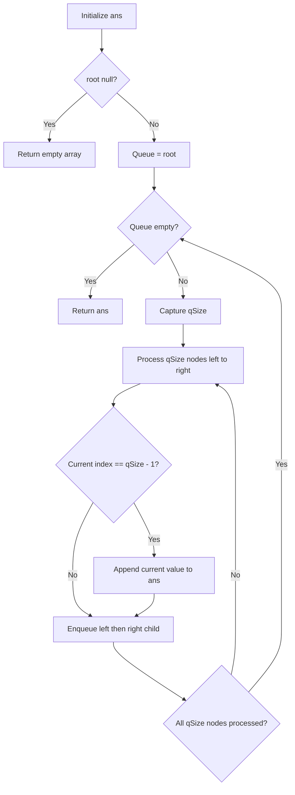

# 199. Binary Tree Right Side View

[← Trees & BST sheet](README.md) · [LeetCode 199](https://leetcode.com/problems/binary-tree-right-side-view/)

**Pattern:** BFS / Level Order Traversal · **Status:** ✅ Solved

## Problem

Given a binary tree, return the values of nodes visible when the tree is viewed from the **right side**, from top to bottom. Only one node per depth is visible: the rightmost node at that level.

## Your corrected solution — BFS + level size

```javascript
var rightSideView = function(root) {
    let ans = [];
    if(!root) return ans;

    let q = [root];
    while(q.length){   
        let qSize = q.length;
        for(let i = 0; i < qSize ; i++){
            let curr = q.shift();
            //push only the last node
            if(i == qSize - 1){
                ans.push(curr.val);
            }
            curr.left && q.push(curr.left);
            curr.right && q.push(curr.right);
        }
    }
    return ans;
};
```

## Diagram

```text
             1  ← visible
            / \
           2   3  ← visible
            \   \
             5   4  ← visible

Level 0: [1]     → select 1
Level 1: [2, 3]  → select 3
Level 2: [5, 4]  → select 4

Answer: [1, 3, 4]
```

## Why this works

1. Empty tree: return `[]`.
2. Put root into a queue.
3. At the start of each BFS level, capture `qSize = q.length`. This is the **number of nodes at the current level**; newly enqueued children belong to the next level.
4. Visit exactly `qSize` nodes, enqueueing each node's **left child before its right child**.
5. The last node processed at that level (`i === qSize - 1`) is its rightmost node. Add only that value to `ans`.
6. Continue until queue is empty.

### Queue dry run

| Level | Queue before processing | `qSize` | Values processed | Selected | Queue after |
|---|---|---:|---|---|---|
| 0 | `[1]` | 1 | `1` | **1** | `[2,3]` |
| 1 | `[2,3]` | 2 | `2,3` | **3** | `[5,4]` |
| 2 | `[5,4]` | 2 | `5,4` | **4** | `[]` |

### Flowchart



## Complexity

- **Logical BFS work:** O(n), visiting every node once.
- **Actual JS `Array.shift()` implementation:** O(n²) worst case due to repeated array reindexing. Replace with a head-index queue for guaranteed O(n) time.
- **Auxiliary space:** O(w) queue, where `w` is maximum tree width.
- **Output:** O(h), one value per level, where `h` is tree height.

## Corner cases

| Tree | Right-side view |
|---|---|
| Empty | `[]` |
| Single node `[1]` | `[1]` |
| Left-skewed `1 → 2 → 3` | `[1,2,3]` |
| Right-skewed `1 → 2 → 3` | `[1,2,3]` |
| Missing right child at some level | Rightmost existing node is still visible |
| Duplicate values | Keep the selected values, even if repeated |

## Left Side View vs Right Side View

With **left-first BFS**, the only change is which index you select:

```javascript
if (i === 0) ans.push(curr.val);         // Left Side View
if (i === qSize - 1) ans.push(curr.val); // Right Side View
```

**Interview takeaway:** You do not have to follow only right pointers. A rightmost visible node might be in a left subtree when right-side branches end early. Process each level and select its final node.

## Mistake corrected

Your first attempt used a queue plus a stack and added every visited node to the answer. That could not reliably select exactly one rightmost node per depth. Your final solution correctly groups nodes by level using `qSize`.
