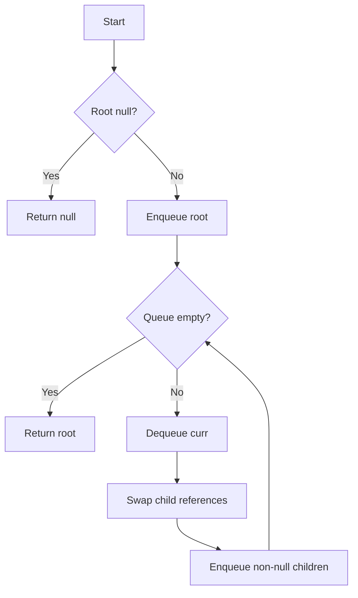
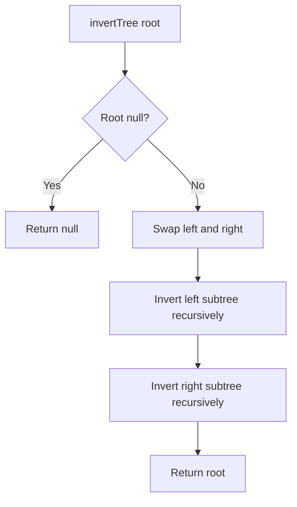

# 226. Invert Binary Tree

[Tree sheet](README.md) | [LeetCode 226](https://leetcode.com/problems/invert-binary-tree/)

## Visual example

```text
Before:          After:
    4               4
   / \             / \
  2   7           7   2
 / \ / \         / \ / \
1  3 6  9       9  6 3  1
```

**Key idea:** Swap each node's `left` and `right` child references, not the values. This moves entire subtrees.

## Approach 1: Iterative BFS (your queue solution)

```js
var invertTree = function(root) {
    if (!root) return null;
    let q = [root];
    while (q.length) {
        let curr = q.shift();
        let temp = curr.left;
        curr.left = curr.right;
        curr.right = temp;

        curr.left && q.push(curr.left);
        curr.right && q.push(curr.right);
    }
    return root;
};
```

Only correction to your original BFS code: `if (!root) return null` instead of `return []`.

### BFS queue dry run

| Step | Process | Swap | Queue after |
|---|---|---|---|
| Start | — | — | [4] |
| 1 | 4 | 2 and 7 | [7,2] |
| 2 | 7 | 6 and 9 | [2,9,6] |
| 3 | 2 | 1 and 3 | [9,6,3,1] |
| 4–7 | 9,6,3,1 | null and null | [] |

At each step: dequeue one node, swap its child references, then enqueue the non-null children. `curr.left && q.push(curr.left)` skips null safely.



**Complexity:** O(n) logical node visits, but JavaScript `shift()` can make worst-case runtime O(n²). Auxiliary queue O(w), maximum width. A head-index queue gives O(n) runtime.

## Approach 2: Recursive DFS (your solution)

```js
var invertTree = function(root) {
    if (!root) return root;

    let temp = root.left;
    root.left = root.right;
    root.right = temp;

    invertTree(root.left);
    invertTree(root.right);

    return root;
};
```

**Top-down preorder-style DFS:** swap current node's child references first, then recursively invert the swapped left and right subtrees.

### Recursive calls and return flow

```text
invertTree(4) : swap 2 ↔ 7
├── invertTree(7) : swap 6 ↔ 9
│   ├── invertTree(9)
│   │   ├── invertTree(null) → null
│   │   └── invertTree(null) → null
│   │   └── returns node 9
│   └── invertTree(6)
│       ├── invertTree(null) → null
│       └── invertTree(null) → null
│       └── returns node 6
│   └── returns node 7
└── invertTree(2) : swap 1 ↔ 3
    ├── invertTree(3) → node 3
    └── invertTree(1) → node 1
    └── returns node 2
returns node 4
```

Why don't we assign the recursive return values? **In-place mutation:** `invertTree(root.left)` directly changes the child object already referenced by the parent. Returning the node is useful to the caller, but not needed for linking.



**Complexity:** O(n) time; O(h) recursion stack (balanced O(log n), skewed O(n)).

## Corner cases

| Input | Expected |
|---|---|
| Null root | Return null |
| Single node | Same node |
| Only left child | Becomes right child |
| Only right child | Becomes left child |
| Both children null | No change |
| Unequal subtrees | Entire child references swap; descendants invert too |

## Comparison

| | Iterative BFS | Recursive DFS |
|---|---|---|
| Processing order | Level order | Preorder-style |
| Work per node | Swap left/right references | Swap left/right references |
| Time | O(n) visits; shift overhead | O(n) |
| Auxiliary space | O(w) queue | O(h) stack |
| Return | Original root (mutated) | Original root (mutated) |

**Remember:** Symmetric Tree compares mirror pairs; Invert Tree swaps the left and right references of each node.
