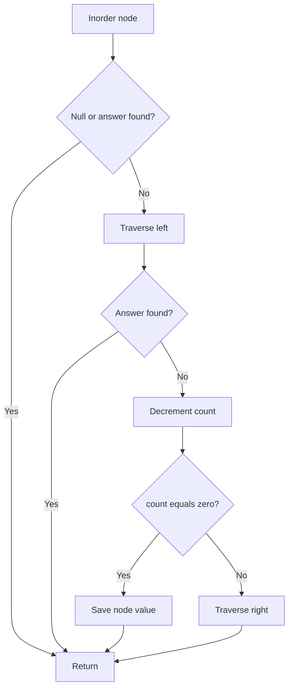

# 230. Kth Smallest Element in a BST

[← Trees & BST](README.md) · [LeetCode 230](https://leetcode.com/problems/kth-smallest-element-in-a-bst/)

**Category:** Binary Search Tree · **Pattern:** Inorder DFS + counter + early stopping · **Difficulty:** Medium

## Problem

Return the kth smallest value in a BST (k is 1-indexed). Inorder traversal of a BST visits keys in ascending order: **Left → Root → Right**.

## Your approach — recursive inorder with counter

Your original approach used `ans = null`, `count = k`, and visited left, root, then right. Two subtle early-stop improvements: test `ans !== null` instead of `if(ans)` because 0 is a valid value; and recheck after returning from the left subtree to avoid visiting parents after finding the answer.

```javascript
var kthSmallest = function(root, k) {
    let ans = null;
    let count = k;

    function inorderTraversal(curr) {
        if (!curr || ans !== null) return;

        // 1. Visit smaller elements first.
        inorderTraversal(curr.left);

        // The answer may have been found in the left subtree.
        if (ans !== null) return;

        // 2. Current node is the next element in sorted order.
        --count;
        if (count === 0) {
            ans = curr.val;
            return;
        }

        // 3. Visit larger elements only if needed.
        inorderTraversal(curr.right);
    }

    inorderTraversal(root);
    return ans;
};
```

## Visual example

```text
        3
       / \
      1   4
       \
        2

k = 2
Inorder: 1 → 2 → 3 → 4
Answer: 2
```

## Dry run

| Visited node | count before | count after | Result |
|---|---:|---:|---|
| 1 | 2 | 1 | Continue |
| 2 | 1 | 0 | Save ans=2, stop |
| 3 | — | — | Skipped |
| 4 | — | — | Skipped |

## Flowchart



## Why it works

The BST property guarantees that all values in the left subtree are smaller than the current node, and all values in the right subtree are larger. Inorder visits values in increasing order, so the kth visited node is the kth smallest. Early stopping avoids exploring the remaining nodes.

## Complexity

- **Time:** O(h + k) with early stopping; worst-case O(n).
- **Auxiliary space:** O(h) recursion stack; balanced O(log n), skewed O(n).
- **Output:** O(1) beyond the recursion stack.

## Corner cases and pitfalls

- **k=1:** leftmost node is the answer.
- **k=n:** rightmost node is the answer.
- **Node value 0:** do not use `if(ans)`; zero is falsy.
- **Negative values:** sorted inorder still works.
- **Early stop:** check for an answer after the left recursive call as well as at function entry.
- **Empty tree:** returns null here; LeetCode guarantees valid k and nonempty BST.

**Interview takeaway:** This is DFS inorder with early stopping; its advantage comes from BST ordering, not from checking each value against every other value.
