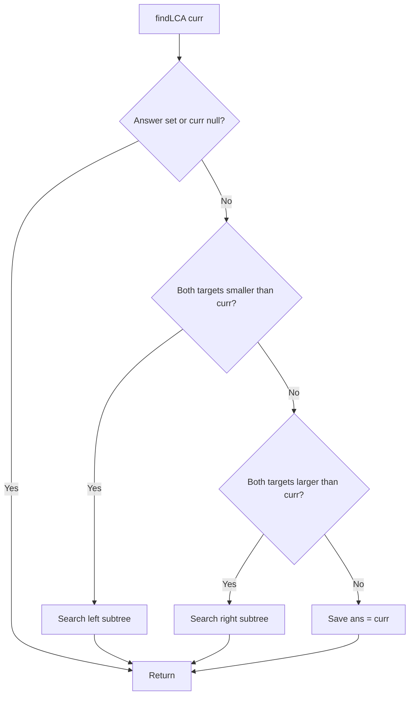

# 235. Lowest Common Ancestor of a Binary Search Tree

[← Trees & BST sheet](README.md) · [LeetCode 235](https://leetcode.com/problems/lowest-common-ancestor-of-a-binary-search-tree/)

**Category:** BST · **Pattern:** Top-down DFS using BST ordering · **Difficulty:** Medium

## Problem

Find the lowest common ancestor of nodes `p` and `q` in a **BST**. A node may be an ancestor of itself. LeetCode guarantees both targets exist in the BST and node values are unique.

## Your corrected solution — recursive search with shared answer

```javascript
var lowestCommonAncestor = function (root, p, q) {
    let ans = null;

    function findLCA(curr) {
        if(ans || !curr) return;

        if (p.val < curr.val && q.val < curr.val) {
            curr.left && findLCA(curr.left);
        }

        else if (p.val > curr.val && q.val > curr.val) {
            curr.right && findLCA(curr.right);
        }
        else ans = curr;
    }

    findLCA(root);
    return ans;
};
```

**Verdict:** Correct under LeetCode 235 constraints. The first comparison directs left only if **both** targets are smaller; the second directs right only if **both** are larger. Otherwise the current node is the split point or equals one target, so it is their LCA.

The `curr.left &&` and `curr.right &&` guards are valid here; `findLCA(curr.left)` and `findLCA(curr.right)` would also work because the helper has a null guard.

## Diagram

```text
              6
             / \
            2   8
           / \ / \
          0  4 7  9
            / \
           3   5

Example A: p=2, q=4 => LCA=2
Example B: p=2, q=8 => LCA=6
Example C: p=3, q=5 => LCA=4
```

## Dry run A — p=2, q=4

| Current node | Both smaller? | Both larger? | Action |
|---|---|---|---|
| 6 | Yes: 2<6 and 4<6 | — | Go left to 2 |
| 2 | No: 2<2 false | No: 2>2 false | Split/equality → `ans = node(2)` |

**Return:** TreeNode with value `2`, not the number `2`.

## Dry run B — p=3, q=5

| Current node | Comparison | Action |
|---|---|---|
| 6 | 3 and 5 are both less than 6 | Left to 2 |
| 2 | 3 and 5 are both greater than 2 | Right to 4 |
| 4 | 3<4, but 5>4 | Split → LCA is 4 |

## Flowchart



## Why this is top-down DFS

The BST property determines which direction contains **both** target nodes. We move downward along one path, not both subtrees. The first node where the targets split (or one target equals the current node) is their **lowest** common ancestor.

## Complexity

- **Time:** O(h), where h is the BST height; O(log n) when balanced, O(n) when skewed.
- **Auxiliary space:** O(h) recursive call stack.
- **No separate traversal array.**

## Compare with LeetCode 236 — Binary Tree LCA

| | 235: BST | 236: General Binary Tree |
|---|---|---|
| Property | Sorted BST ordering | No ordering guaranteed |
| Approach used | Top-down directional DFS | Bottom-up subtree target counting |
| Time | O(h) | O(n) |
| Return | LCA TreeNode | LCA TreeNode |

## Interview notes / edge cases

- `p` can itself be the LCA when `q` lies in its subtree.
- If targets are on opposite sides of the root, the root is LCA.
- Always compare `p.val` and `q.val` against `curr.val`, **not** against the node object `curr`.
- `if(ans || !curr) return` handles found answers and null nodes.
- The recursive search can also directly return a node, eliminating the outer `ans` variable.
- An iterative version uses O(1) extra space.
