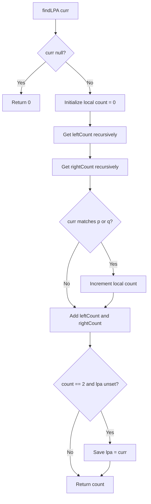

# ⭐ IMPORTANT — 236. Lowest Common Ancestor of a Binary Tree

[← Trees & BST sheet](README.md) · [LeetCode 236](https://leetcode.com/problems/lowest-common-ancestor-of-a-binary-tree/)

**Priority: ⭐ Important — revise for interviews and recursion return-value flow.**

## Problem

Find the **lowest (deepest)** node that is an ancestor of both target nodes `p` and `q`. A node can be an ancestor of **itself**. LeetCode 236 guarantees `p` and `q` are distinct and both exist in the tree; node values are unique.

## Your solution — Bottom-up DFS + counting + shared LCA

```javascript
var lowestCommonAncestor = function(root, p, q) {
    let lpa = null;

    function findLPA(curr){
        if(!curr) return 0;
        let count = 0;

        let leftCount = findLPA(curr.left);
        let rightCount = findLPA(curr.right);

        if(curr.val == p.val || curr.val == q.val){
            count++;
        }
        count = count + leftCount + rightCount;
        if(count == 2 && !lpa){
            lpa = curr;
        }
        return count;
    }
    findLPA(root);
    return lpa;
};
```

**Your solution is correct for LeetCode 236 constraints.** For general binary trees, compare node identity (`curr === p || curr === q`) rather than values; duplicates can make value comparison incorrect. `lpa` is just a variable name; `lca` is conventional.

## Visual tree

```text
                  3
                 / \
                5   1
               / \
              6   4

p = 5, q = 4
LCA = 5 (a node may be an ancestor of itself)
```

## ⭐ Key concept: Why does local count work if it resets to zero?

Each recursive **function invocation has its own local variables**. Thus, each invocation starts with a fresh `let count = 0`. The count is **not shared**. Child calls communicate their subtree totals through `return count`, which the parent receives in `leftCount` and `rightCount`.

```text
findLPA(5) starts:
    its OWN count = 0
    leftCount  = findLPA(6) → returns 0
    rightCount = findLPA(4) → returns 1
    current node 5 matches p → its count++ → 1
    count = 1 + 0 + 1 = 2
    lpa = node 5
    return 2 to parent node 3

findLPA(3) has a DIFFERENT local count = 0
    leftCount  = findLPA(5) → 2
    rightCount = findLPA(1) → 0
    count = 0 + 2 + 0 = 2
    lpa already points to node 5 → do not overwrite
    return 2
```

**Do not confuse:** `findLPA(4)` returning 1 **does not change** node 5's local `count` automatically. The return value is stored in `rightCount`, and only then explicitly added:

```javascript
let rightCount = findLPA(curr.right);
count = count + leftCount + rightCount;
```

### Call stack mental model

```text
CALL PHASE (down):
findLPA(3) — local count 0, pauses waiting for children
  findLPA(5) — separate local count 0, pauses
    findLPA(6) — separate local count 0 → return 0
    findLPA(4) — separate local count 0 → match q → return 1

RETURN PHASE (up):
    4 returns 1 → node 5 receives rightCount=1
  5 adds self 1 + children 0,1 → returns 2; stores lpa=5
3 receives leftCount=2, keeps lpa=5
```

## Bottom-up dry run

| Node | leftCount | rightCount | self match | count returned | lpa |
|---|---:|---:|---:|---:|---|
| 6 | 0 | 0 | 0 | 0 | null |
| 4 | 0 | 0 | 1 (q) | 1 | null |
| 5 | 0 | 1 | 1 (p) | 2 | **5** |
| 1 | 0 | 0 | 0 | 0 | 5 |
| 3 | 2 | 0 | 0 | 2 | **5** |

### Why the first count == 2 is the LOWEST ancestor

The function processes **left subtree, then right subtree, then current node** (postorder DFS). A descendant with both targets is processed **before** any ancestor containing both. So the first node reaching count 2 is the deepest common ancestor. `&& !lpa` prevents higher ancestors from replacing it.

## Flowchart



## Local variable vs shared variable

| `count` | `lpa` |
|---|---|
| Declared inside helper | Declared once outside helper |
| Fresh 0 in each recursive call | Shared by all calls via closure |
| Subtree count passed upward via return | Stores the final answer |
| Each stack frame has its own copy | One shared reference |

## Complexity

- **Time: O(n)** — visits each node once.
- **Space: O(h)** — recursion stack; balanced O(log n), skewed O(n).
- This implementation traverses the whole tree even after `lpa` is found.

## Corner cases

- `p` is an ancestor of `q`: LCA can be `p` itself.
- `q` is an ancestor of `p`: LCA can be `q` itself.
- Targets in different root subtrees: LCA is the root.
- Both targets deep in one subtree: LCA is inside that subtree, not necessarily root.
- Skewed tree: works, O(n) stack worst case.
- `root = null`: returns null (outside standard target-existence constraints).
- General trees with duplicate values: use **reference equality**, not value equality.

## ⭐ Interview revision notes

1. **Return values move bottom-up**, not shared local variables.
2. A fresh `count = 0` per call is **necessary**; child totals come through `leftCount` and `rightCount`.
3. Postorder processing ensures deepest qualifying node is found before ancestors.
4. `!lpa` prevents overwriting the first valid LCA.
5. Contrast with Diameter of Binary Tree: helper returns height; outer shared variable tracks global maximum. Here helper returns target count; outer shared variable tracks LCA.
