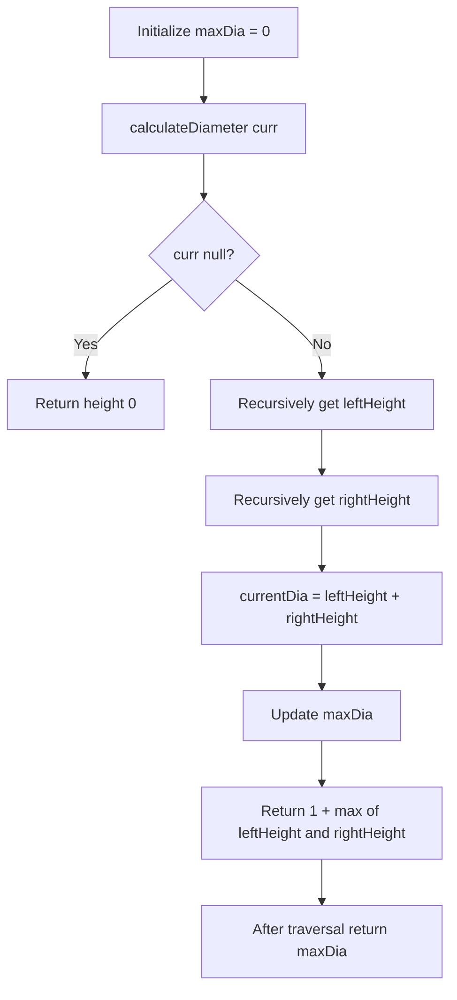

# 543. Diameter of Binary Tree — Bottom-up DFS

[← Trees & BST](README.md) · [LeetCode 543](https://leetcode.com/problems/diameter-of-binary-tree/)

## Problem

Return the **number of edges** on the longest path between any two nodes. The path **does not have to pass through the root**.

## Your final solution

```javascript
var diameterOfBinaryTree = function(root) {
    let maxDia = 0;
    function calculateDiameter(curr){
        if(!curr) return 0;

        let leftHeight = calculateDiameter(curr.left);
        let rightHeight = calculateDiameter(curr.right);

        let currentDia = leftHeight + rightHeight;
        maxDia = Math.max(maxDia ,currentDia );
        return 1 + Math.max(leftHeight , rightHeight)
    }

    calculateDiameter(root);
    return maxDia;
};
```

## Diagram

```text
          1
         / \
        2   3
       / \   \
      4   5   6

Longest path: 4 → 2 → 1 → 3 → 6
Number of nodes = 5
Number of edges (diameter) = 4
```

At each node, the longest path **through that node** consists of its deepest left branch and deepest right branch:

`currentDia = leftHeight + rightHeight`

Here heights are counted in **nodes**, while `currentDia` counts **edges**: the two downward branches contribute one edge per node in their respective subtree heights.

**Two separate jobs:**
- `maxDia = Math.max(maxDia, currentDia)` updates the answer for the whole tree.
- `return 1 + Math.max(leftHeight, rightHeight)` returns the current subtree's **height** to the parent, not its diameter.

## Bottom-up DFS call and return flow

```text
calculateDiameter(1)
├── calculateDiameter(2)
│   ├── calculateDiameter(4)
│   │   ├── null → height 0
│   │   └── null → height 0
│   │   ↳ currentDia=0, return height 1
│   └── calculateDiameter(5)
│       ├── null → 0
│       └── null → 0
│       ↳ currentDia=0, return height 1
│   ↳ currentDia=1+1=2, maxDia=2, return height 2
└── calculateDiameter(3)
    ├── null → height 0
    └── calculateDiameter(6)
        ├── null → 0
        └── null → 0
        ↳ currentDia=0, return height 1
    ↳ currentDia=0+1=1, maxDia=2, return height 2

At node 1:
  leftHeight=2, rightHeight=2
  currentDia=4, maxDia=4
  return height 3

Final answer: 4 edges
```

| Node (postorder) | Left height | Right height | currentDia | maxDia | Height returned |
|---|---:|---:|---:|---:|---:|
| 4 | 0 | 0 | 0 | 0 | 1 |
| 5 | 0 | 0 | 0 | 0 | 1 |
| 2 | 1 | 1 | 2 | 2 | 2 |
| 6 | 0 | 0 | 0 | 2 | 1 |
| 3 | 0 | 1 | 1 | 2 | 2 |
| 1 | 2 | 2 | 4 | 4 | 3 |

## Flowchart



## Why check every node?

The longest path may lie entirely inside a subtree and **not** cross the overall root. By updating `maxDia` at every node, we find the maximum path anywhere.

## Complexity

- **Time: O(n)** — each node is processed once.
- **Auxiliary space: O(h)** — recursion stack, where h is tree height; O(log n) balanced, O(n) skewed.

## Corner cases

| Tree | Diameter |
|---|---:|
| Empty tree (`null`) | 0 |
| Single node | 0 |
| Two connected nodes | 1 |
| Three-node chain | 2 |
| Perfect tree with 3 levels | 4 |
| Longest path entirely below root | Maximum diameter found in that subtree |

**Important fix from your first attempt:** Initialize `maxDia = 0`, not `-Infinity`. Otherwise an empty tree returns `-Infinity`.

## Pattern connection

- **Maximum Depth (104):** Return `1 + max(leftHeight, rightHeight)`.
- **Balanced Binary Tree (110):** Also check `abs(leftHeight - rightHeight) <= 1` at each node.
- **Diameter (543):** Update global maximum using `leftHeight + rightHeight` at each node.

All three use **bottom-up DFS (postorder height computation)**.
